# PriceBack — a price-drop guarantee engine on PayPal

[](https://priceback.onrender.com/)


[](LICENSE)

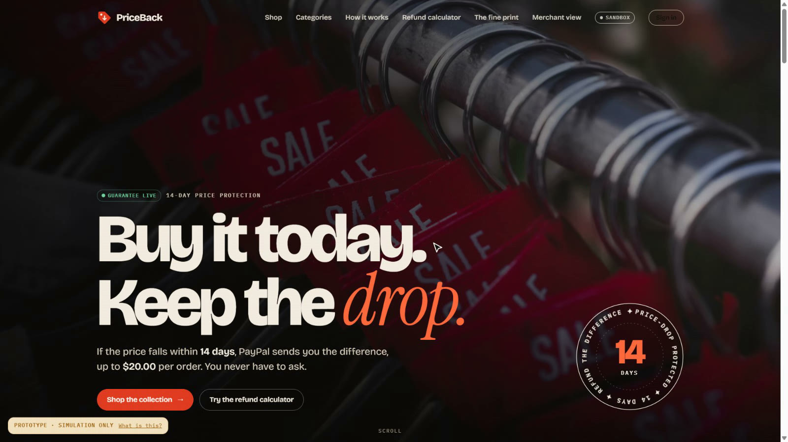

A merchant types a promise in plain English:

> "Refund the difference if the price drops within 14 days, up to $20 per order and $100 per day."

PriceBack compiles it into a validated policy, watches market prices for every covered order, and issues
the **partial refund through PayPal** automatically — with hard guardrails, idempotent retries, a
full audit trail, and a webhook-verified ledger. No claim forms, no screenshots of cheaper prices, no emails to support.

Built for the [PayPal AI Hackathon](https://paypalaihackathon.devpost.com/). PayPal is the core: take it out
and nothing works. The AI model is swappable.

|  |  |
|---|---|
| **Live demo** | [priceback.onrender.com](https://priceback.onrender.com/) (store) · [/merchant](https://priceback.onrender.com/merchant) → *Explore as a guest* (console) |
| **Run it yourself** | [**SIMULATION-GUIDE.md**](SIMULATION-GUIDE.md): a click-by-click local walkthrough, with or without a PayPal account |
| **Money** | PayPal **sandbox** only. Test money, nothing real is ever charged |

> The live demo runs on Render's free plan, which sleeps when idle: the first load can take up to a minute.

## Contents

[See it in action](#see-it-in-action) · [How it works](#how-it-works) · [Safety properties](#safety-properties) ·
[Try it live](#try-it-live) · [Run it locally](#run-it-locally) · [PayPal sandbox setup](#paypal-sandbox-setup) ·
[Configuration](#configuration) · [API](#api) · [Deploy on Render](#deploy-on-render) · [Honest limits](#honest-limits) ·
[Sponsor tools](#sponsor-tools) · [Project layout](#project-layout) · [Tests](#tests)

## See it in action

Real captures of the running app (PayPal sandbox, test money).

### 1 · The merchant writes the promise

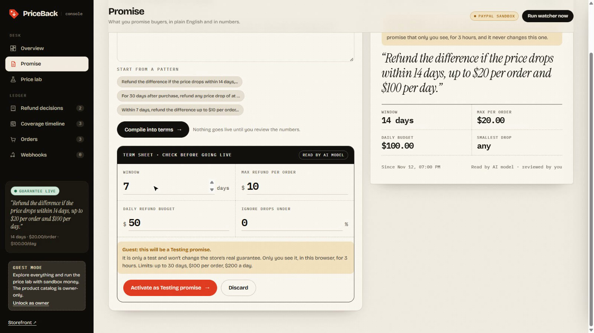

Type the promise, **Compile into terms**, check the numbers. The AI only fills in the form; nothing goes live until the
merchant reviews and activates it. (This capture is in guest mode, where an activated promise becomes a private,
3-hour *Testing promise* and the store's real guarantee is never touched.)

### 2 · A shopper signs in and pays with PayPal

<table>
<tr>
<td width="50%">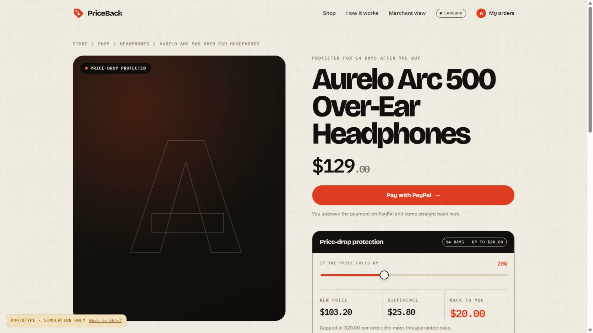<br><sub><b>Product page.</b> The slider shows what a price drop would pay back, using the store's live promise.</sub></td>
<td width="50%">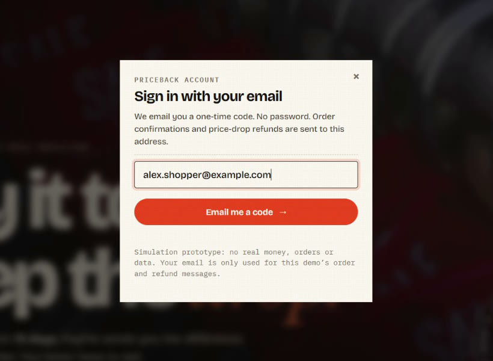<br><sub><b>Passwordless sign-in.</b> A one-time code by email, so refunds and receipts reach the right person.</sub></td>
</tr>
<tr>
<td width="50%">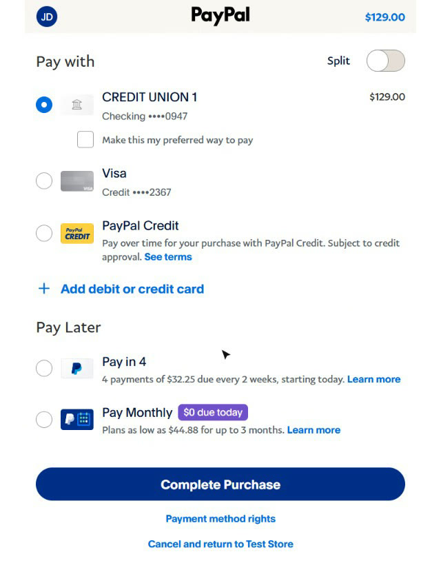<br><sub><b>Real PayPal sandbox checkout.</b> Orders v2: create, approve, capture. Test money only.</sub></td>
<td width="50%">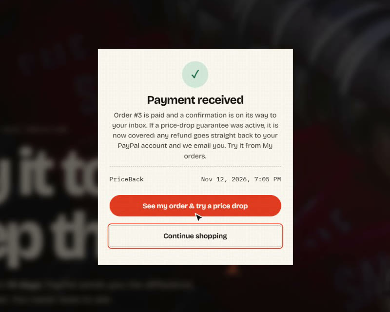<br><sub><b>Back on the store.</b> The promise in force at that moment is saved onto the order, so later changes can't take it away.</sub></td>
</tr>
</table>

### 3 · The price drops, and the engine reacts

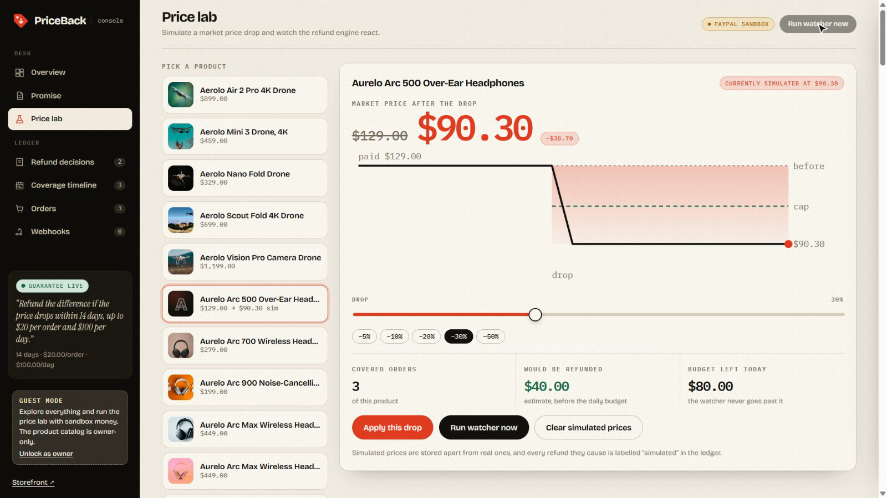

The **Price lab** simulates a market drop (clearly labelled *simulated* everywhere) and previews what it would cost.
**Run watcher now** (on Render, a 60-second background watcher does the same) settles every covered order of that product.

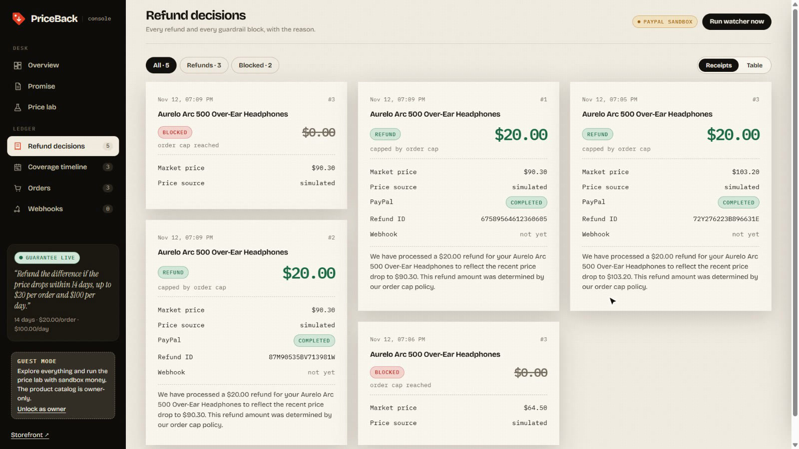

Every refund **and every block** is recorded with its reason: `capped_by_order_cap`, `order_cap_reached`,
`daily_budget_exhausted`, `full_difference`. The PayPal refund id and the customer message are stored with it.

### 4 · The shopper is paid back, automatically

<table>
<tr>
<td width="50%">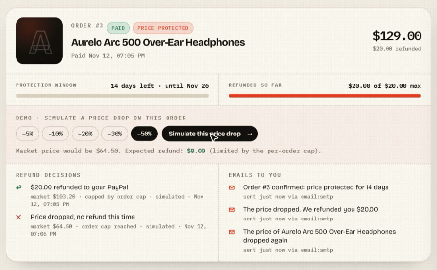<br><sub><b>My orders.</b> Protection window, refunded-so-far against the cap, every decision, and every email sent.</sub></td>
<td width="50%">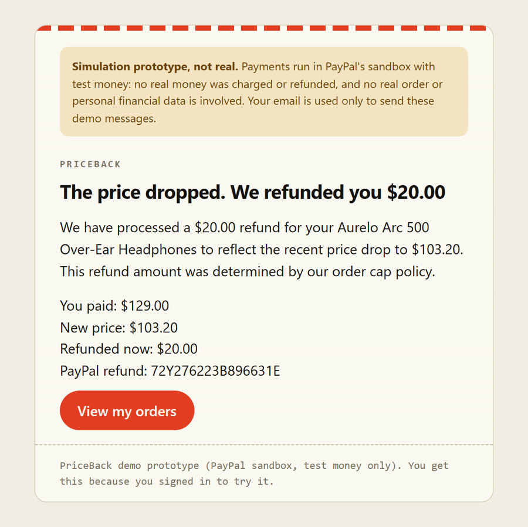<br><sub><b>The refund email.</b> Sent once per event, never twice. Facts come from code; the AI only phrases them.</sub></td>
</tr>
</table>

### 5 · The merchant keeps a full audit trail

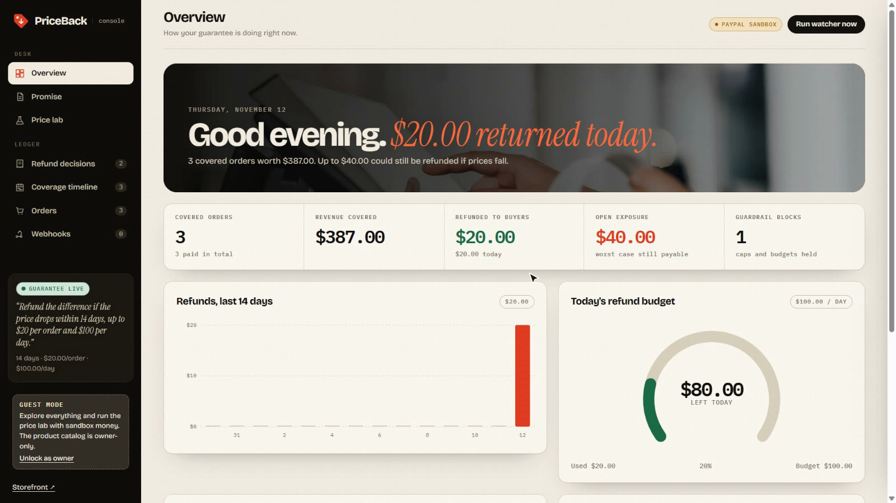

<table>
<tr>
<td width="50%">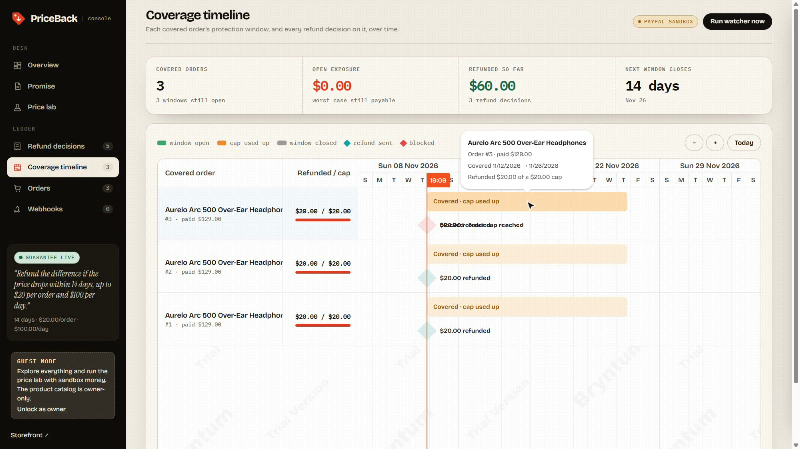<br><sub><b>Coverage timeline</b> (Bryntum Scheduler). One bar per covered order, markers for each refund or block, a line for <i>now</i>.</sub></td>
<td width="50%">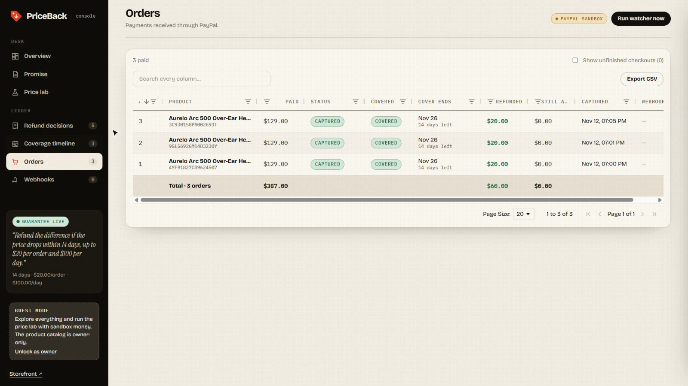<br><sub><b>Orders grid</b> (AG Grid). Search, filter, CSV export, and totals that follow your filters.</sub></td>
</tr>
</table>

## How it works

```
merchant promise ──► policy compiler (LLM, regex fallback) ──► validated Policy ──► merchant reviews & activates
shopper ──► PayPal Orders v2 (create → approve → capture) ──► order stored with a snapshot of the promise
watcher ──► market price (Channel3 live, or simulated) ──► evaluate() guardrails ──► PayPal partial refund
PayPal ──► signed webhooks ──► ledger confirms captures & refunds
```

**PayPal APIs used:** Orders v2 (create, capture), Payments v2 (partial refund of a capture, with
`PayPal-Request-Id`), Webhooks (signature verification, `PAYMENT.CAPTURE.COMPLETED`, `PAYMENT.CAPTURE.REFUNDED`).

**AI:** the LLM turns the promise into JSON and writes the customer message. It never touches money — only a
validated `Policy` reaches the refund path, and every amount is computed by deterministic code.

**Catalog:** the merchant adds products in the console (`/merchant → Catalog`), and/or imports them from
**Channel3** (`POST /v1/search`, live market price via `GET /v1/products/{id}`, lowest in-stock offer) when
`CHANNEL3_API_KEY` is set. A fresh install starts with an empty shelf unless `SEED_CATALOG=true`, which loads
`app/seed_catalog.json` (100 products in 11 categories plus the starting promise) into an empty database.

## Safety properties

All unit-tested.

- Per-order cap is **cumulative**; a separate **daily budget** is shared across all orders.
- Decision + write-ahead `pending_api` row commit in one `BEGIN IMMEDIATE` transaction, so concurrent runs can't both spend the same cap.
- `PayPal-Request-Id` is derived from (order, price, refunded-so-far, attempt): retrying the same intent **cannot refund twice**.
- Network errors / 5xx / 429 are *unknown outcomes*: they stay pending and are retried with the **same** key. Only definite 4xx rejections become `FAILED`.
- Checkout price always comes from the server catalog, never from the client; captured amount is verified against it.
- Orders keep the promise they bought under; orders placed before any promise are never refunded.
- Webhooks: signature verified via PayPal (raw body forwarded verbatim), deduplicated by event id; **unverified events never change state**.
- Refuses non-sandbox PayPal URLs unless `PAYPAL_ALLOW_LIVE=true`.

## Try it live

Everything below works on the [live demo](https://priceback.onrender.com/) with fake money.

### As a shopper

1. Open the store and click **Sign in** (or just **Pay with PayPal**). Enter your own email; we send a one-time code.
2. Buy any product. A sheet shows the **PayPal sandbox buyer login** to use on PayPal's page (fake money).
3. You land back on the store; open **My orders** (`/account`). You get an *order confirmed* email.
4. Pick a drop (−5 % … −50 %) and click **Simulate this price drop**. The engine settles *your order only*: PayPal refunds the
   difference (up to the cap) and a *we refunded you $X* email arrives within seconds. Drop it further to see the cap block it.

Emails go out through **SMTP with Python's `smtplib`** (e.g. Gmail with an app password; set `SMTP_*`) or through
**Brevo's HTTPS API** (`BREVO_API_KEY`). Both are free; use Brevo on Render's free plan, which blocks outbound SMTP. Each event is stored in
a `notifications` outbox with a unique key, so a shopper is never emailed twice for the same event. If `ZAPIER_HOOK_URL`
is set, every event is **also POSTed to a Zapier Catch Hook** as JSON (`event`, `email`, `subject`, `message`, `order_id`,
`account_url`), ready for any Zap (Slack, Google Sheets, SMS…). Sign-in codes are never sent to Zapier.

### As a merchant

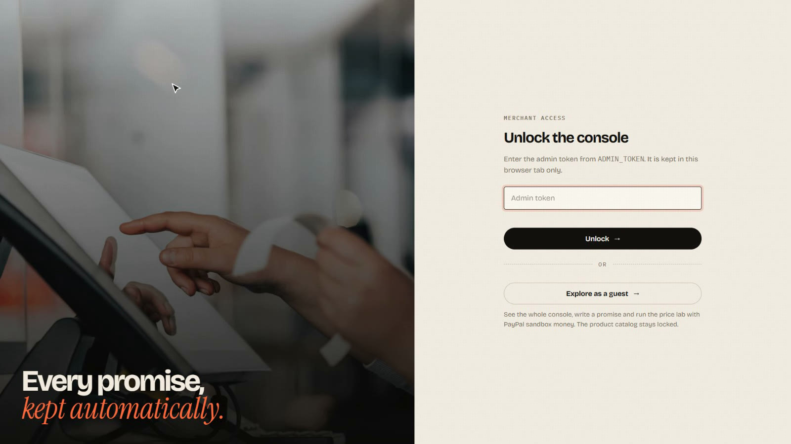

Open `/merchant` and click **Explore as a guest** (on when `DEMO_MERCHANT_GUEST=true`, as in `render.yaml`). Guests see the
overview, refund decisions, orders, coverage timeline and webhooks, and can drop prices in the **Price lab** and run the
watcher, which refunds every covered buyer of that product. Only the owner (`ADMIN_TOKEN`) can add, edit, remove or import
products. Guests see shoppers' emails masked (`ju•••@example.com`) and share an hourly allowance of AI promise previews.

**Testing promises.** A promise a guest activates never replaces the store's real one. It becomes a *Testing promise*:
shown only in that guest's browser (a random `pb_gid` cookie), labelled "Testing promise (yours)" on the store, and gone
after **3 hours**. Orders placed under it use its terms, are labelled Testing in the console, on *My orders* and in the
emails, and draw on the test promise's own daily budget, never the store's. Guest promises are held to demo limits
(≤ 30 days, ≤ $100 per order, ≤ $200 a day). So a judge can write a promise, buy under it and watch the refund, while other
shoppers keep seeing the real guarantee.

## Run it locally

The full click-by-click walkthrough, with the exact numbers you should see at each step, is in
**[SIMULATION-GUIDE.md](SIMULATION-GUIDE.md)**. The short version (Python 3.12+):

```powershell
git clone https://github.com/jainamd05/PriceBack.git
cd PriceBack
python -m venv .venv
.\.venv\Scripts\Activate.ps1          # macOS / Linux: source .venv/bin/activate
pip install -r requirements-dev.txt
pytest -q                             # 66 tests, no network, no keys
```

Then pick how payments run:

| | **A · Pretend PayPal** (no accounts) | **B · PayPal Sandbox** (real PayPal API, fake money) |
|---|---|---|
| Setup | none | PayPal developer account + sandbox app, ~20 min |
| Start | `python simulation-screenshots/tools/run_with_pretend_paypal.py` | copy `.env.example` → `.env`, add your keys, then `uvicorn app.main:app --reload` |
| Open | http://127.0.0.1:8010 | http://localhost:8000 |
| Real | the whole PriceBack app: checkout, capture, guardrails, idempotent refunds, emails, console | the same, plus real Orders / Payments / Webhook calls |
| Pretend | the PayPal pages and API (a local stand-in that honours `PayPal-Request-Id`) | nothing |

Mode A starts with the 100-product catalog and the 14-day promise already loaded; for mode B set `SEED_CATALOG=true` in
`.env` on the first run. Without PayPal credentials, mode B's store and console still load, but **Pay with PayPal**
returns a clear 503.

## PayPal sandbox setup

Only for mode B and for deploying. Details and troubleshooting are in the [guide](SIMULATION-GUIDE.md).

1. developer.paypal.com → **Apps & Credentials → Sandbox → Create app**. Copy Client ID / Secret into `.env`.
2. In **Testing Tools → Sandbox Accounts** make sure there is a **Business** (merchant) and a **Personal** (buyer) account,
   **both in the United States** (the store charges USD). You pay with the Personal one.
3. Run the app, open `/merchant`, then buy a product on `/` and approve it on PayPal with the buyer account.
4. On `/merchant`: **Price lab** → pick the product → **Apply this drop** → **Run watcher now**. A refund appears with status `COMPLETED`.
5. Confirm it in the sandbox Business account's **Activity**.
6. **Webhooks:** Dashboard → your app → *Webhooks → Add webhook* with URL `${PUBLIC_BASE_URL}/api/webhooks/paypal` and events
   `PAYMENT.CAPTURE.COMPLETED`, `PAYMENT.CAPTURE.REFUNDED`. Put the *Webhook ID* in `PAYPAL_WEBHOOK_ID`.
   Locally you need a tunnel (ngrok / cloudflared) because PayPal must reach the URL. Rows in the ledger show *verified*.

If a refund fails, the error text is stored on the settlement row (Refund decisions → "Customer message").

## Configuration

Copy `.env.example` to `.env` (it is git-ignored; never commit it). Every variable is documented there. The ones that matter:

| Variable | What it does |
|---|---|
| `PAYPAL_CLIENT_ID`, `PAYPAL_CLIENT_SECRET` | Sandbox app credentials. Without them checkout returns 503 |
| `PAYPAL_WEBHOOK_ID` | Webhook id used to verify PayPal's signature |
| `PUBLIC_BASE_URL` | Where PayPal sends the buyer back. Must equal the address you browse (`http://localhost:8000`, or your `https://…onrender.com` URL) |
| `ADMIN_TOKEN` | Console password. **Required on any public deployment.** Left blank locally, the console opens without a password |
| `DEMO_MERCHANT_GUEST` | `true` adds **Explore as a guest** to the console (everything except the catalog) |
| `DEMO_SELF_SERVE` | `true` (default) lets a shopper simulate a price drop on their own order |
| `DEMO_BUYER_EMAIL`, `DEMO_BUYER_PASSWORD` | Sandbox *buyer* login shown to testers before PayPal opens (fake money only, never a real account) |
| `SEED_CATALOG` | `true` loads the 100-product catalog and the 14-day promise into an **empty** database |
| `CHANNEL3_API_KEY`, `CATALOG_QUERY`, `CATALOG_SIZE` | Optional live product import and market prices |
| `GEMINI_API_KEY`, `LLM_MODEL` | Optional AI for promise parsing and customer messages. Rule-based fallbacks otherwise |
| `BREVO_API_KEY` + `MAIL_FROM`, or `SMTP_*` | Optional email. With neither, sign-in codes appear on screen and emails are only recorded |
| `ZAPIER_HOOK_URL` | Optional: mirror every shopper event to a Zapier Catch Hook |
| `WATCH_INTERVAL_SECONDS` | Run the watcher automatically every N seconds. `0` = only on **Run watcher now** |
| `DEFAULT_DAILY_BUDGET` | Daily budget used when a promise doesn't state one |
| `PRICEBACK_DB` | SQLite file (default `priceback.db`) |

## API

| Public | |
|---|---|
| `GET /api/products`, `GET /api/guarantee`, `GET /api/demo` | catalog, active promise (summary), sandbox buyer login for testers |
| `POST /api/auth/start`, `POST /api/auth/verify`, `POST /api/auth/logout`, `GET /api/me` | shopper sign-in with an emailed 6-digit code |

| Shopper (signed in) | |
|---|---|
| `POST /api/checkout` | create PayPal order → `approve_url` (the order is tied to the shopper's email) |
| `GET /api/me/orders` | my orders, protection window, refund decisions, emails sent |
| `POST /api/me/orders/{id}/simulate-drop` | **demo**: simulate a market drop on *my* order only and settle it |
| `GET /checkout/return` | capture + snapshot the promise |
| `POST /api/webhooks/paypal` | verified webhook ledger |

| Merchant (`x-admin-token` when `ADMIN_TOKEN` is set) | |
|---|---|
| `POST /api/policy/compile`, `POST /api/policy/activate`, `GET /api/policy` | promise lifecycle |
| `POST /api/simulate/drop`, `POST /api/simulate/reset` | **simulated** price changes |
| `POST /api/products`, `PATCH /api/products/{id}`, `DELETE /api/products/{id}` | add / edit (name, photo, category; never the price) / remove a catalog product |
| `POST /api/watch/run`, `POST /api/catalog/refresh` | settle now, import from Channel3 |
| `GET /api/orders`, `/api/settlements`, `/api/ledger`, `/api/stats`, `/api/notifications` | audit trail, dashboard data, notification outbox |

Interactive API docs are served at `/docs` while the app runs.

## Deploy on Render

`render.yaml` is included. Set the secret env vars in the Render dashboard (`PUBLIC_BASE_URL` must be your
`https://…onrender.com` URL), then register the webhook (step 6 above). The free plan's disk is ephemeral, so the SQLite DB
resets on each deploy, restart and spin-down; `SEED_CATALOG=true` (set in `render.yaml`) brings the products and the promise
back, while orders and sign-ins start fresh. Attach a disk for durability. Render's free plan also blocks outbound SMTP, so
use `BREVO_API_KEY` + `MAIL_FROM` there.

## Honest limits

- **Price drops in the demo are simulated** (clearly labelled `simulated` in the DB, API and UI). Channel3 prices are
  real for the baseline and the live check, but real prices won't move within a hackathon.
- "Market price" = the lowest in-stock Channel3 offer in USD; it is a proxy, not the merchant's own competitor feed.
- Sandbox only: refund timing, fees and payer funding sources aren't representative of production.
- Channel3's docs don't specify the image field in search results; it's parsed defensively. `/merchant → Catalog → Import from Channel3`
  prints the response keys so you can confirm.
- Single-process SQLite; no multi-merchant tenancy, auth is a single shared admin token.

## Sponsor tools

| Tool | Where | What it does in PriceBack |
|---|---|---|
| **PayPal** (Orders v2, Payments v2 refunds, Webhooks) | core | Checkout, capture, automatic partial refunds, verified webhook ledger |
| **Channel3** (search + live price) | `app/channel3.py`, `/merchant → Catalog → Import from Channel3` | Imports real products and supplies the live market price the watcher compares against (needs `CHANNEL3_API_KEY`) |
| **AG Grid** Community | `app/static/console-grids.js` | The console's data grids: **Orders** (sort, filter, search, CSV export, a totals row that follows your filters, "cover ends" and "still at risk" columns), **Refund decisions → Table** (an auditable, exportable ledger of every refund and guardrail block), **Webhooks**, and **Catalog → Table** (edit names and categories in place, multi-select bulk remove) |
| **Bryntum Scheduler** (trial build) | `app/static/console-timeline.js`, `/merchant → Coverage timeline` | One row per covered order: the bar is the protection window the buyer bought under, diamonds are each refund or block on that order, and a line marks *now*. Shows at a glance which guarantees are open, which have used up their cap, and what expires next |
| **Zapier** (optional) | `app/notify.py` | Mirrors every shopper event (order confirmed, refund sent, refund blocked) to a Zapier Catch Hook when `ZAPIER_HOOK_URL` is set |
| **Render** | `render.yaml` | One-click Blueprint deploy (Python web service, health check, generated `ADMIN_TOKEN`, watcher every 60 s) |

AG Grid and Bryntum are loaded from the jsDelivr CDN (`ag-grid-community@34.3.1`, `@bryntum/scheduler-trial@7.3.7`), so
there is still no build step. If the CDN is unreachable, the console falls back to its plain HTML tables.

## Project layout

```
app/
  main.py             FastAPI app: pages plus the public, shopper and merchant API
  policy.py           promise compiler (LLM + rule fallback), Testing promises
  settle.py           evaluate() guardrails and idempotent PayPal refunds
  watcher.py          one settlement pass over every covered order
  paypal.py           Orders v2, Payments v2 and webhook-verification client
  prices.py           catalog, simulated prices, Channel3 import
  shoppers.py         passwordless email sign-in
  notify.py           order and refund emails (SMTP or Brevo) and the Zapier mirror
  webhooks.py         webhook event processing
  static/             store, product page, My orders and the merchant console (no build step)
  seed_catalog.json   100 products and the starting promise
tests/                66 tests against an in-memory PayPal fake
simulation-screenshots/tools/   run_with_pretend_paypal.py: the app with a local stand-in for PayPal
docs/screenshots/     the images used in this README and the guide
render.yaml           one-click Render Blueprint
SIMULATION-GUIDE.md   the local walkthrough
```

## Tests

`pytest -q` — 66 tests: policy parsing (LLM + fallback), guardrail math, idempotency/recovery, the full checkout →
simulated drop → refund flow, shopper sign-in and notifications, the guest console and Testing promises, admin auth, and
webhook verification/dedup, all against an in-memory PayPal fake that mimics `PayPal-Request-Id` semantics.

## License

MIT
