# PriceBack — Local Simulation Guide

Run the **whole** PriceBack process on your own computer, click by click: a merchant makes a promise, a shopper
pays with PayPal, the price drops, and the difference is refunded automatically — then watch the guardrails stop
the refunds that should be stopped.

Every step says **what to click**, **what to type**, **what you should see** and **what happened behind the scenes**.
Every number in this guide was produced by running these exact steps against the current code.

> Everything is fake money. You never enter a real card or a real PayPal login, and nothing real is charged or refunded.

**Time:** about 15 minutes for the core flow (Parts 1–7), about 30 for everything.

## Contents

1. [The story in one picture](#the-story-in-one-picture)
2. [Choose how payments run](#choose-how-payments-run)
3. [Install](#install)
4. [Configure](#configure)
5. [Start the app](#start-the-app)
6. **The walkthrough**
   - [Part 1 — Merchant: open the console and check the promise](#part-1--merchant-open-the-console-and-check-the-promise)
   - [Part 2 — Shopper: sign in and buy](#part-2--shopper-sign-in-and-buy)
   - [Part 3 — Shopper: look at the order](#part-3--shopper-look-at-the-order)
   - [Part 4 — Merchant: see the covered order](#part-4--merchant-see-the-covered-order)
   - [Part 5 — Merchant: drop the price, get an automatic refund](#part-5--merchant-drop-the-price-get-an-automatic-refund)
   - [Part 6 — Check where the money moved](#part-6--check-where-the-money-moved)
   - [Part 7 — Run it again: the guardrail blocks the repeat](#part-7--run-it-again-the-guardrail-blocks-the-repeat)
   - [Part 8 — More test cases](#part-8--more-test-cases)
   - [Part 9 — Shopper self-serve: simulate the drop from My orders](#part-9--shopper-self-serve-simulate-the-drop-from-my-orders)
   - [Part 10 — Guest mode and Testing promises](#part-10--guest-mode-and-testing-promises)
7. [Optional: webhooks](#optional-webhooks-mode-b-only)
8. [Run the automated tests](#run-the-automated-tests)
9. [Reference: what each console page means · why a refund was or wasn't paid](#reference)
10. [Start completely fresh](#start-completely-fresh)
11. [If something goes wrong](#if-something-goes-wrong)

---

## The story in one picture

```
 YOU AS THE MERCHANT                 YOU AS THE SHOPPER                 PRICEBACK (automatic)
 ───────────────────                 ──────────────────                 ─────────────────────
 1. Write a promise in English  ──►  2. Sign in, buy a product    ──►   3. Snapshot the promise onto the order
    "refund the difference..."          with PayPal                      4. Watch the market price
                                                                         5. Price dropped? Run the guardrails
 6. Drop the price (simulated)  ──────────────────────────────────────►  7. Send a partial refund through PayPal
                                     8. See the refund + the email  ◄──  9. Log everything (audit trail)
```

You will use **three browser tabs**. The address depends on the mode you pick below:

| Tab | Mode A (Pretend PayPal) | Mode B (PayPal Sandbox) | Who you are |
|---|---|---|---|
| Store | http://127.0.0.1:8010 | http://localhost:8000 | the shopper |
| My orders | `/account` on the same address | `/account` on the same address | the shopper |
| Merchant console | `/merchant` on the same address | `/merchant` on the same address | the shop owner |

> **Use one address, consistently.** `localhost` and `127.0.0.1` are different sites to a browser: they don't share
> cookies. Your sign-in and your Testing promise live in cookies, and PayPal sends you back to the address in
> `PUBLIC_BASE_URL`. If a step "forgets" you, check the address bar.

---

## Choose how payments run

PriceBack talks to PayPal to create the order, capture it and send the refund. You can run the **real app** against
either of these:

| | **Mode A · Pretend PayPal** | **Mode B · PayPal Sandbox** |
|---|---|---|
| Accounts needed | none | a free PayPal developer account |
| Setup time | ~5 min | ~20–30 min |
| Runs the real PriceBack code | yes: checkout, capture, promise snapshot, guardrails, idempotent refunds, emails, console | yes, the same |
| The payment screens and API | a local stand-in (`simulation-screenshots/tools/run_with_pretend_paypal.py`) that behaves like PayPal, including *same `PayPal-Request-Id` = same refund* | the real PayPal sandbox (Orders v2, Payments v2) |
| Webhooks | not available | optional (needs a tunnel) |
| Start with it if | you just want to see it work | you want to see the actual PayPal API do it |

**Start with Mode A**, then repeat Parts 2 and 6 in Mode B if you want the real thing. Everything else in the guide is
identical. Differences are marked **Mode A** / **Mode B**.

---

## Install

You need **Python 3.12 or newer**, **Git** and a browser (Chrome, Edge or Firefox). An internet connection is
recommended: the console loads its grids and timeline (AG Grid, Bryntum) from a CDN, and product photos come from
Unsplash. Without it the console falls back to plain tables and some product photos may not load.

**Windows (PowerShell):**

```powershell
git clone https://github.com/jainamd05/PriceBack.git
cd PriceBack
python -m venv .venv
.\.venv\Scripts\Activate.ps1
pip install -r requirements-dev.txt
```

**macOS / Linux:**

```bash
git clone https://github.com/jainamd05/PriceBack.git
cd PriceBack
python3 -m venv .venv
source .venv/bin/activate
pip install -r requirements-dev.txt
```

> If PowerShell says *"running scripts is disabled on this system"*, run
> `Set-ExecutionPolicy -Scope Process -ExecutionPolicy Bypass` and activate again (it only affects that window). Or skip
> activation and put `.\.venv\Scripts\python -m` in front of commands, e.g. `.\.venv\Scripts\python -m pytest -q`.

**Check the install.** This needs no network and no keys:

```powershell
pytest -q
```

You should see **`66 passed`** (about 30 seconds).

---

## Configure

Mode A needs no configuration, but a small `.env` gives you the full experience (the console password screen and guest
mode). Mode B needs one.

```powershell
Copy-Item .env.example .env        # macOS / Linux:  cp .env.example .env
```

Open `.env` in Notepad or VS Code and set these lines (keep the rest as they are). `.env` is git-ignored: never
commit it.

| Variable | Set it to | Why |
|---|---|---|
| `ADMIN_TOKEN` | any word you will remember, e.g. `letmein` | The console password. **Left blank, the console opens with no password** and you won't see the *Unlock* screen or guest mode |
| `DEMO_MERCHANT_GUEST` | `true` | Adds **Explore as a guest** to the console (Part 10) |
| `SEED_CATALOG` | `true` | An **empty** database gets 100 products and the 14-day promise. Without it Mode B starts with an empty store. *(Mode A turns this on by itself.)* |
| `PUBLIC_BASE_URL` | `http://localhost:8000` (already the default) | Where PayPal sends the buyer back. Must be the exact address you browse |
| `PAYPAL_CLIENT_ID`, `PAYPAL_CLIENT_SECRET` | your sandbox app's keys | **Mode B only**, see below |
| `DEMO_BUYER_EMAIL`, `DEMO_BUYER_PASSWORD` | optional, **Mode B**: uncomment and fill in your sandbox *Personal* login | The store then shows it in a sheet right before PayPal opens, so you don't have to look it up |
| `BREVO_API_KEY`, `SMTP_*` | **leave empty** (commented out) | Empty = no email provider, so the sign-in code appears **on screen** and emails are only *recorded*. Fill them in later if you want real emails |
| `GEMINI_API_KEY` | optional | With it the promise is read by an AI model and the customer message is AI-worded; without it a rule-based reader and message templates are used. The numbers are identical |

> **Email.** If you do configure `BREVO_API_KEY` + `MAIL_FROM` or `SMTP_*`, the sign-in code and the order / refund emails
> go to whatever address you type at sign-in, so use your own.
>
> **After editing `.env`, restart the app.** `--reload` only watches code files, not `.env`.

### Mode B only: your PayPal sandbox accounts and keys

1. Go to https://developer.paypal.com and click **Log in to Dashboard**. Use your normal PayPal login.
2. **Testing Tools → Sandbox Accounts**. You need two accounts:
   - a **Business** (merchant) account: where the money lands, and where you will check the refund;
   - a **Personal** (buyer) account: what you pay with. Note its **Email ID** and **Password** (use *Change password* if none is shown).

   > ⚠ **Both must have Country = United States**: the store charges in USD, and PayPal stops with *"This seller doesn't
   > accept payments in your currency"* otherwise. Click **⋯ → View/Edit account** to check; if one isn't US, use
   > **Create account** to make a US one.
3. **Apps & Credentials → Sandbox → Create App** (type *Merchant*), and link it to your **US Business** account.
   Copy its **Client ID** and **Secret** into `PAYPAL_CLIENT_ID` and `PAYPAL_CLIENT_SECRET` in `.env`.

| Account | Email | Password | Used in |
|---|---|---|---|
| Console password (`ADMIN_TOKEN`) | none | what you put in `.env` | Part 1 |
| Sandbox **Personal** (buyer) | sb-…@personal.example.com | … | Part 2, paying |
| Sandbox **Business** (merchant) | sb-…@business.example.com | … | Part 6, checking the refund |

---

## Start the app

Leave this terminal window open for the whole session. Closing it, or pressing **Ctrl + C**, stops the app.

### Mode A · Pretend PayPal

```powershell
python simulation-screenshots\tools\run_with_pretend_paypal.py
```

You should see:

```
PriceBack (real app) + PRETEND PayPal on http://127.0.0.1:8010  -  database: ...\simulation-run.db
Pretend PayPal merchant activity (payments and refunds it received): http://127.0.0.1:8010/pretend-paypal/activity
INFO:     Application startup complete.
```

Open **http://127.0.0.1:8010**. (Optional arguments: `python ...\run_with_pretend_paypal.py <database file> <port>`.)

### Mode B · PayPal Sandbox

```powershell
python -m uvicorn app.main:app --reload
```

You should see `INFO:     Application startup complete.` Open **http://localhost:8000**.

> **Behind the scenes (both modes):** the server (FastAPI) creates the SQLite database, and because it's empty and
> `SEED_CATALOG` is on, loads **100 products in 11 categories** and the starting promise
> *"Refund the difference if the price drops within 14 days, up to $20 per order and $100 per day."* In Mode A the PayPal
> client is swapped for an in-memory stand-in; nothing else in `app/` changes.

---

## The walkthrough

I use these two products. Prices come from the seed catalog (`app/seed_catalog.json`):

| Product | Price | Direct link (Mode A shown; swap the host for Mode B) |
|---|---|---|
| **Aurelo Arc 500 Over-Ear Headphones** | $129.00 | `http://127.0.0.1:8010/product/m-77a51388b9` |
| **Glidex Shadow Wireless Mouse** | $45.00 | `http://127.0.0.1:8010/product/m-ec53f4a341` |

> Screenshots below come from a longer session than this guide, so order numbers, dates and a few extra rows will differ
> from yours. The numbers in the *text* are what you should see.

### Part 1 — Merchant: open the console and check the promise

1. In a browser tab open **`/merchant`**.
2. If you set `ADMIN_TOKEN`, you get the **Unlock the console** screen:

   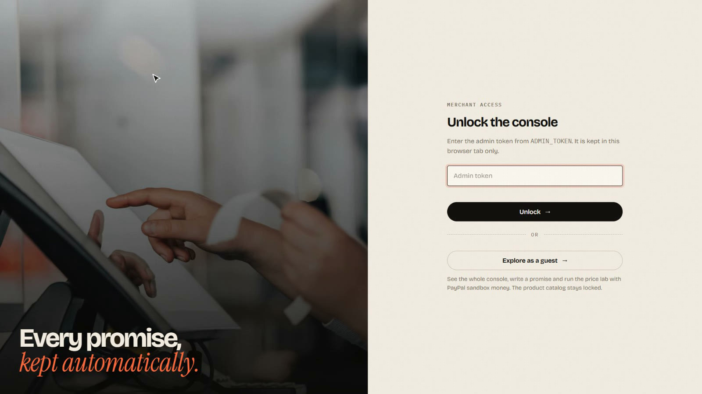

   Type your `ADMIN_TOKEN` and click **Unlock →**. (The **Explore as a guest** button is Part 10; skip it for now. If you
   left `ADMIN_TOKEN` blank, there is no password screen and you land straight in the console.)
3. You land on **Overview**. With no orders yet it says *"Promise is live."* and every tile is zero.
4. Click **Promise** in the left menu. **Current guarantee** shows the seeded promise, stamped **In force**:

   | Window | Max per order | Daily budget | Smallest drop |
   |---|---|---|---|
   | 14 days | $20.00 | $100.00 | any |

5. Now do the merchant's job yourself. Under **Replace it with a new promise**, click the first pattern chip (it fills
   the box with *"Refund the difference if the price drops within 14 days, up to $20 per order and $100 per day."*) and
   click **Compile into terms →**.
6. A black **Term sheet · check before going live** appears with four editable boxes, and a badge **read by AI model**
   or **read by rules**:

   | Field | Value |
   |---|---|
   | Window | `14` days |
   | Max refund per order | `$20` |
   | Daily refund budget | `$100` |
   | Ignore drops under | `0` % |

   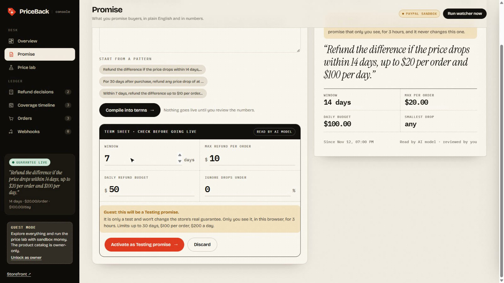

   Check the numbers match the sentence. Don't change anything.
7. Click **Activate promise →**. A message says
   *"Promise is live. New orders are covered; earlier orders keep the promise they bought under."*

> **Behind the scenes:** an AI model (Gemini) or, without a key, a rule-based reader turns your sentence into those four
> numbers, and the result is checked against strict limits. **The AI never moves money. It only fills in this form.**
> *You* approve the numbers, and from then on plain, tested code does all the maths. Re-activating the same promise is
> harmless; it just records a new version.

### Part 2 — Shopper: sign in and buy

1. Open a **new tab** at the store address (`/`). You see the hero *"Buy it today. Keep the drop."* and the
   *Guarantee live · 14-day price protection* badge.
2. Open the Aurelo Arc 500 page: use the direct link above, or **Shop** and search for `Arc 500`.

   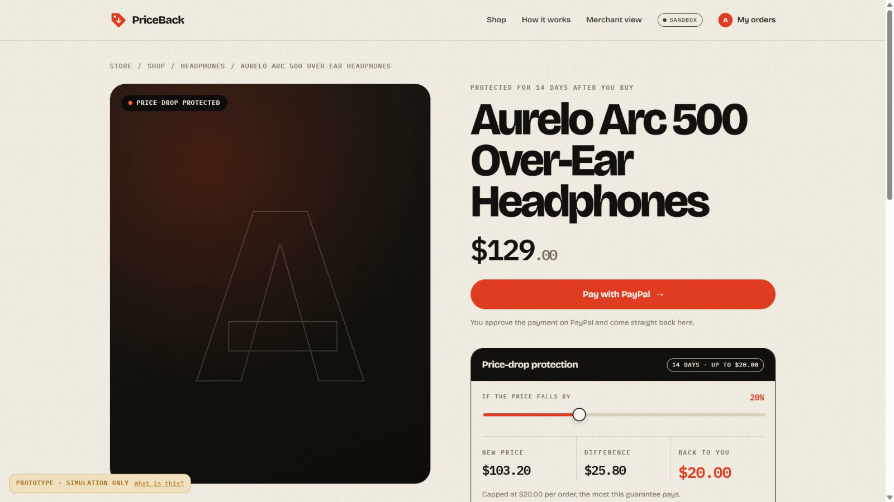

   The **price-drop slider** starts at 20 %. The store's own calculator shows:

   | New price | Difference | Back to you |
   |---|---|---|
   | $103.20 | $25.80 | **$20.00** (capped at $20 per order) |

3. Click **Pay with PayPal →**. You aren't signed in, so a **Sign in with your email** box opens.
4. Type any email address you like and click **Email me a code →**.
   - **No email provider configured (the default here):** the next box, **Enter the 6-digit code**, shows a line
     *"Local mode: no email service is configured, so here is the code: 123456"* (the same code is printed in your
     terminal). Type it in.
   - **Email provider configured:** the code arrives in that inbox (check spam).

   You are signed in: the top bar now says **My orders**.
5. **Mode B, if you set `DEMO_BUYER_EMAIL`:** a sheet *"Use the PayPal sandbox buyer"* shows the login to use on PayPal's page.
   Click **Continue to PayPal →**. (In Mode A, or without that setting, this sheet is skipped.)
6. **Pay:**

   | Mode | What you see and do |
   |---|---|
   | **A** | A page headed **PRETEND PAYPAL** (*"Not paypal.com, no real or sandbox money"*) showing the item and **$129.00 USD**. Click the blue **Pay Now** |
   | **B** | The PayPal sandbox (`https://www.sandbox.paypal.com/...`). Enter your **Personal** buyer email → **Next** → password → **Log In**, leave the payment method as it is, and click **Complete Purchase** (some versions say **Pay Now**) |

   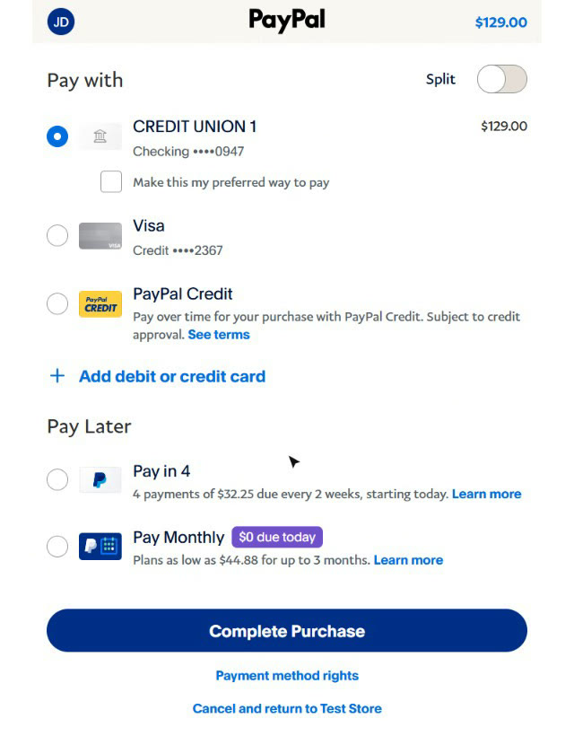

   > **Mode B tips.** Use the **Personal** account, never the Business one (a shop can't pay itself). If you land on a
   > form asking for phone, name and card number, that's guest checkout: don't fill it; use **Log In** instead. If PayPal
   > shows *"Things don't appear to be working"*, wait 30 seconds and click **Pay with PayPal** again.
7. PayPal sends you back to the store and a **Payment received** box appears:

   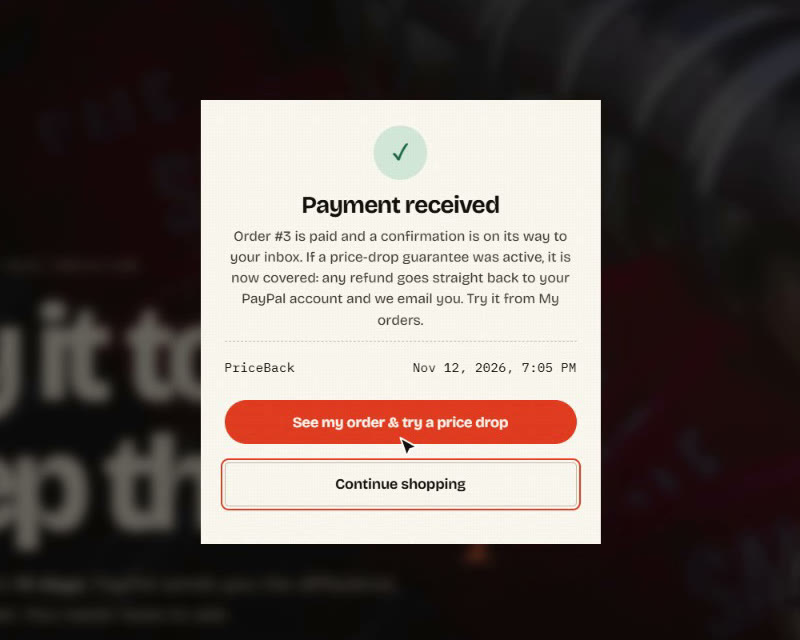

   Remember the **order number** (#1 on a fresh database).

> **Behind the scenes (three steps):**
> 1. **Create order.** The server asks PayPal for a $129.00 order. The price comes from the server's catalog, **never from
>    the browser**, so nobody can edit the page and pay $1.
> 2. **You approve** it on PayPal's page.
> 3. **Capture.** On return, the server takes the money and checks PayPal captured exactly $129.00. It also **saves a copy
>    of the active promise onto the order** (the snapshot), so if the merchant changes the promise later, this order
>    keeps the promise it was bought under. It then queues an *order confirmed* email.

### Part 3 — Shopper: look at the order

Click **See my order & try a price drop** (or **My orders** in the top bar, or go to `/account`). You see the order
card:

- **Order #1 · PAID · PRICE PROTECTED**, Aurelo Arc 500 Over-Ear Headphones, **$129.00**, *nothing refunded yet*.
- **Protection window:** *14 days left*, with the end date.
- **Refunded so far:** *$0.00 of $20.00 max*.
- **Refund decisions:** *No price drop yet.*
- **Emails to you:** *Order #1 confirmed: price protected for 14 days.* With no email provider it's marked
  *recorded (email sending is off on this server)*; with one, *sent just now via email:…*.

Leave this tab open; you'll come back to it.

### Part 4 — Merchant: see the covered order

Switch to the **console** tab. It refreshes by itself every few seconds (or press **F5**).

- **Overview** tiles:

  | Tile | Value | Meaning |
  |---|---|---|
  | Covered orders | `1` | paid orders covered by a promise |
  | Revenue covered | `$129.00` | money from those orders |
  | Refunded to buyers | `$0.00` | nothing refunded yet |
  | Open exposure | `$20.00` | the most you could still owe: the $20 cap |
  | Guardrail blocks | `0` | |

- **Orders** (left menu): one row, **#1 · Aurelo Arc 500 … · $129.00 · CAPTURED · COVERED**, with the *cover ends* date
  (14 days away), *Refunded $0.00* and *Still at risk $20.00*.

  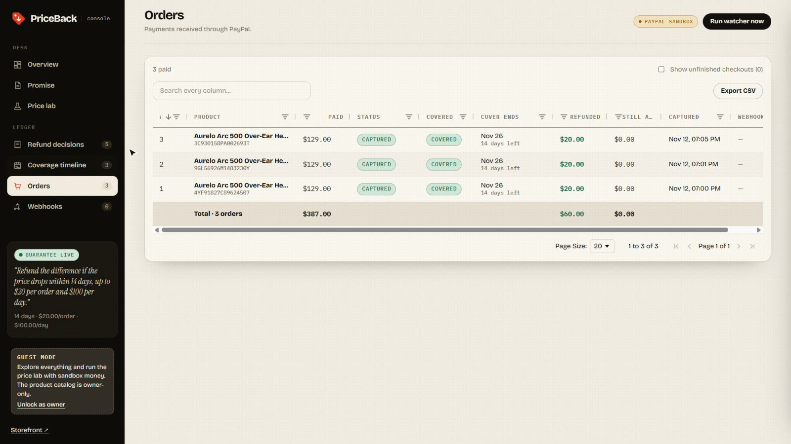

- **Coverage timeline:** a bar for the order, from the purchase to the end of the protection window.

> An order that was *started but never paid* shows up only if you tick **Show unfinished checkouts**. PriceBack never
> refunds an unpaid order.

### Part 5 — Merchant: drop the price, get an automatic refund

Real prices don't move during a demo, so the console lets you **simulate** a drop. Every simulated price is labelled
`simulated` in the database, the API and the screen.

1. Click **Price lab**. On the left, scroll the alphabetical product list and pick
   **Aurelo Arc 500 Over-Ear Headphones**. The right side shows *Market price after the drop* and a **Drop** slider.
2. Click the **−20 %** chip. The panel now reads:

   | | |
   |---|---|
   | Market price | ~~$129.00~~ **$103.20** (−$25.80) |
   | Covered orders | `1` of this product |
   | Would be refunded | `$20.00` (an estimate, before the daily budget) |
   | Budget left today | `$100.00` |

3. Click **Apply this drop**. A message says
   *"Simulated market price for Aurelo Arc 500 Over-Ear Headphones is now $103.20. Run the watcher to settle."*

   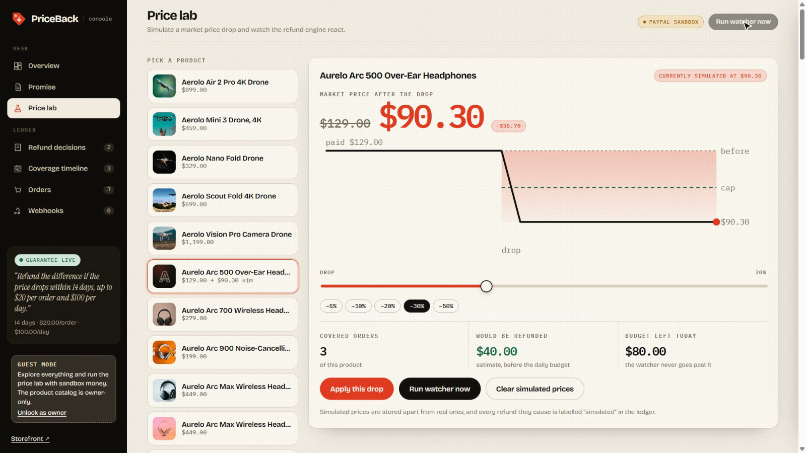

4. Click **Run watcher now**. You should see:
   *"Checked 1 order(s): 1 refunded, 0 blocked by guardrails."*
5. Open **Refund decisions**. A new **REFUND** receipt:

   | Order | Action | Amount | Reason | Market price | Price source | PayPal | Customer message |
   |---|---|---|---|---|---|---|---|
   | #1 Aurelo Arc 500 … | **REFUND** | **$20.00** | capped by order cap | $103.20 | simulated | **COMPLETED** + a refund id | *"The price of Aurelo Arc 500 Over-Ear Headphones dropped from $129.00 to $103.20. Under our price-drop guarantee we refunded $20.00 to your PayPal account. This is the maximum our guarantee covers on a single order."* |

   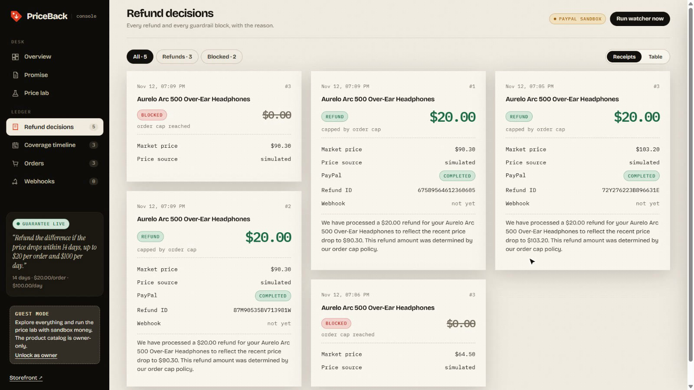

   **Overview** now reads: *"$20.00 returned today."*, **Refunded to buyers $20.00**, **Open exposure $0.00**, and the
   *Today's refund budget* gauge shows **$80.00 left** of $100.00.

### Why $20.00 and not $25.80? (the maths the code did)

| | |
|---|---|
| You paid | $129.00 |
| New market price | $103.20 (20 % lower) |
| Difference owed | $25.80 |
| Already refunded on this order | $0.00 |
| Cap left on this order | $20.00 (the promise says up to $20 per order) |
| Daily budget left | $100.00 |
| **Refund = the smallest of (owed, cap left, budget left)** | **$20.00**, reason `capped_by_order_cap` |

> **Behind the scenes, in order:**
> 1. The **watcher** looks at every paid, covered order and gets the current market price for its product: the simulated
>    price first, then the live Channel3 price (if configured), then the catalog price.
> 2. `evaluate()`, a pure function, runs eight checks in order and stops at the first that fails: *captured?* →
>    *valid price?* → *still inside the window?* → *did the price really drop?* → *big enough a drop?* → *anything still
>    owed?* → *cap left on this order?* → *daily budget left?*
> 3. Before calling PayPal, the decision is written to the database inside one locked transaction, so two watchers
>    running at once can't both spend the same $20.
> 4. The refund goes to PayPal with a unique **`PayPal-Request-Id`** built from (order, price, refunded-so-far, attempt).
>    If the network fails and it retries, PayPal sees the same id and **does not refund twice**.
> 5. The customer message is worded by the AI model (using only the facts it is given) or by a template.
> 6. The *refund sent* email is queued once, keyed to this exact event.

### Part 6 — Check where the money moved

| Mode | How to check |
|---|---|
| **A** | Open **`/pretend-paypal/activity`** on the same address. **Payments received** lists *+$129.00*; **Refunds sent** lists *-$20.00* with its `PayPal-Request-Id`. At the bottom: *Refund API calls received: 1 · unique refunds created: 1* |
| **B** | Open a **private / incognito window** (so you're logged out of the buyer account), go to https://www.sandbox.paypal.com, and log in with the **Business** sandbox account. **Activity** shows the **$129.00** payment and a **$20.00 refund** (the payment may read *Partially refunded*). Logging in as the **Personal** account instead shows the $20.00 *received* |

### Part 7 — Run it again: the guardrail blocks the repeat

1. Click **Run watcher now** again, changing nothing.
2. You should see: *"Checked 1 order(s): 0 refunded, 1 blocked by guardrails."*
3. **Refund decisions** gets a **BLOCKED** receipt: **$0.00**, *order cap reached*. The **Guardrail blocks** tile
   becomes `1`.
4. Click **Run watcher now** a **third** time. The message still says *1 blocked*, but **no new row** appears: the same
   block is logged once, not on every run.
5. Back on the shopper's **My orders** tab (reload it): the order now says **$20.00 refunded**, **Refunded so far
   $20.00 of $20.00 max** (a full red bar), the decision *"$20.00 refunded to your PayPal"* and a second line *"Price
   dropped, no refund this time"*, and the emails *"The price dropped. We refunded you $20.00"* and *"The price of Aurelo
   Arc 500 Over-Ear Headphones dropped again"*.

   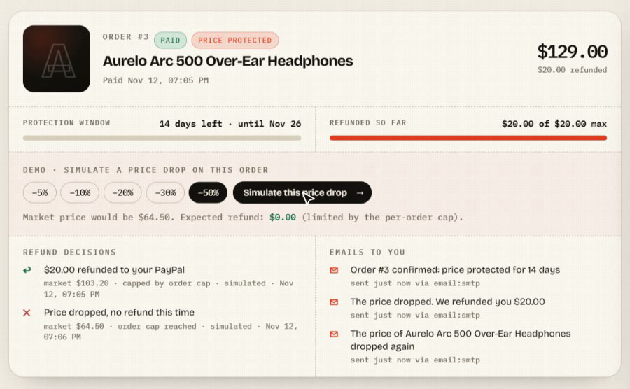

   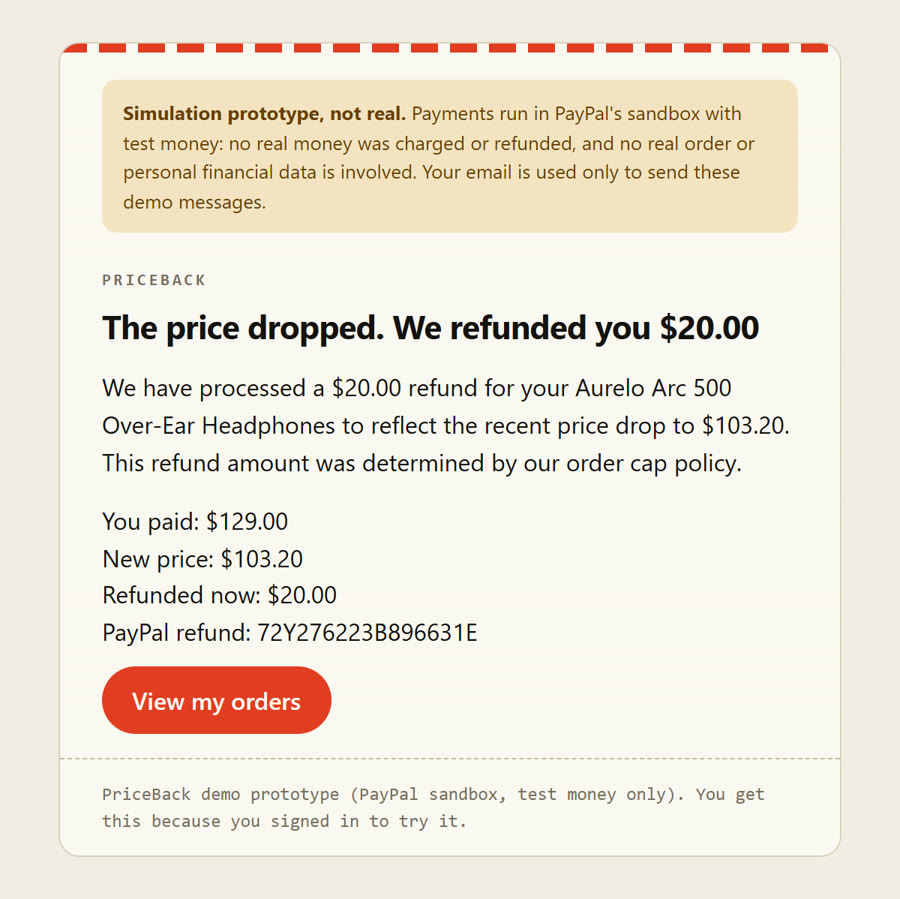

> **Why:** $5.80 is technically still "owed" ($25.80 − $20.00), but the order has used its whole $20 cap. **The cap is
> cumulative**: it adds up across every refund on the same order, so a price that keeps falling can never cost you more
> than the promise says.

🎉 **That's the complete core flow:** promise → purchase → price drop → automatic, capped PayPal refund → blocked repeat.

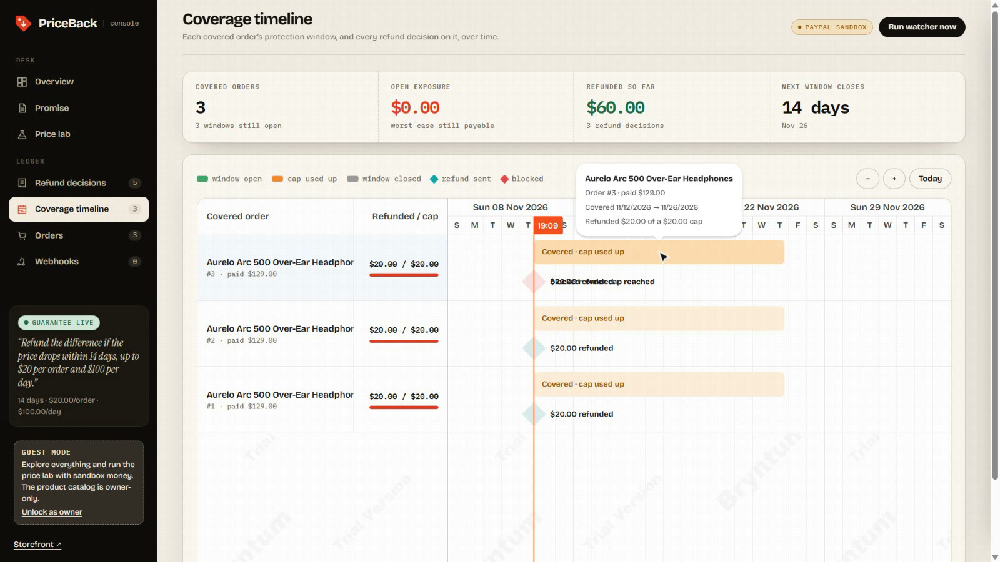

---

### Part 8 — More test cases

Do these in order. **A** to **D** need one more purchase (the mouse); **E** needs one more after that.

#### Set-up: buy the mouse

Repeat **Part 2** for **Glidex Shadow Wireless Mouse ($45.00)**. It becomes order **#2**.

#### A. A small drop → the full difference is refunded

1. Console → **Price lab** → **Clear simulated prices** (so the headphones are back to normal) → message
   *"Simulated prices cleared. Market prices are back to normal."*
2. Scroll the list to **Glidex Shadow Wireless Mouse**, choose **−10 %** → **Apply this drop** (*"…is now $40.50…"*).
3. **Run watcher now** → *"Checked 2 order(s): 1 refunded, 0 blocked by guardrails."*
4. New receipt: **REFUND · $4.50 · full difference** (owed $4.50 is below the $20 cap, so it is paid in full).

#### B. The price falls further → only the *extra* difference is refunded

1. Same product, choose **−30 %** → **Apply this drop** (*"…is now $31.50…"*).
2. **Run watcher now** → *"Checked 2 order(s): 1 refunded, 0 blocked by guardrails."*
3. New receipt: **REFUND · $9.00 · full difference**.

   Why $9.00: the mouse is now $13.50 cheaper ($45.00 − $31.50), minus the $4.50 already refunded = **$9.00**. Total
   refunded on the mouse: $13.50. **Overview:** *Refunded to buyers $33.50*, *Today's refund budget $66.50 left*.

#### C. No price drop → nothing happens

1. **Clear simulated prices** → **Run watcher now**.
2. *"Checked 2 order(s): 0 refunded, 0 blocked by guardrails."* No new rows: with no drop there is nothing to refund
   (and nothing worth logging).

#### D. The daily budget stops refunds

The daily budget is shared by **all** orders and always follows the **currently active** promise.

1. **Promise** → type in the box: `Refund the difference if the price drops within 14 days, up to $20 per order and $25 per day.`
   → **Compile into terms →** → check **Daily refund budget** says `25` → **Activate promise →**.
2. **Price lab** → the mouse → **−50 %** (now $22.50) → **Apply this drop** → **Run watcher now**.
3. *"Checked 2 order(s): 0 refunded, 1 blocked by guardrails."* New receipt: **BLOCKED · daily budget exhausted**. Today
   you've already refunded $33.50, more than $25. **Overview** shows *$0.00 left* in the budget gauge.
4. **Put it back:** **Promise** → type the original sentence (`…and $100 per day.`) → **Compile into terms →** →
   **Activate promise →**, then **Price lab → Clear simulated prices**.

> The daily budget **resets at midnight UTC**.

#### Expected results at a glance

| Scenario | Paid | Market | Already refunded | Result | Reason |
|---|---|---|---|---|---|
| Headphones −20 % | $129.00 | $103.20 | $0.00 | refund **$20.00** | `capped_by_order_cap` |
| Headphones, run again | $129.00 | $103.20 | $20.00 | **blocked** | `order_cap_reached` |
| Mouse −10 % | $45.00 | $40.50 | $0.00 | refund **$4.50** | `full_difference` |
| Mouse −30 % | $45.00 | $31.50 | $4.50 | refund **$9.00** | `full_difference` |
| Clear simulated prices (no drop) | any | normal | any | nothing | `no_drop` (not logged) |
| Daily budget $25, mouse −50 % | $45.00 | $22.50 | $13.50 | **blocked** | `daily_budget_exhausted` |
| Order paid **before** any promise | any | any | any | never refunded | not covered (unit-tested) |

### Part 9 — Shopper self-serve: simulate the drop from My orders

A signed-in shopper can try the whole thing on **their own order**, with no console. (This is what the live demo
offers visitors; it's on when `DEMO_SELF_SERVE=true`, the default.) Make sure your promise is back to **$100 per day**
(Part 8·D step 4), then:

1. Buy the **Aurelo Arc 500 Over-Ear Headphones** again (a new order, e.g. **#3**), signed in as the same email.
2. **My orders** → find the new order. Under **Demo · simulate a price drop on this order**, choose **−20 %**; the line
   below reads *"Market price would be $103.20. Expected refund: $20.00 (limited by the per-order cap)."*
3. Click **Simulate this price drop →**. A message says *"$20.00 refunded through PayPal. Check your inbox."* The order
   shows **$20.00 refunded**, and the refund email appears under **Emails to you**.
4. Choose **−50 %** and click again: *"No refund: order cap reached. You were emailed about it."*

> Only **this order** is settled, and the product's real price is untouched, so other shoppers' orders aren't affected.
> Every guardrail (window, per-order cap, daily budget) still applies, and the refund is labelled `simulated`.

### Part 10 — Guest mode and Testing promises

Guest mode lets anyone explore the console without the password, and write their own promise **without** changing the
store's real one. (Needs `DEMO_MERCHANT_GUEST=true`; this is how the live demo works.)

1. In the console click **Lock** (bottom of the left menu) or open `/merchant` in a **private window**, and on the
   **Unlock the console** screen click **Explore as a guest →**.
2. You see everything except **Catalog** (it's owner-only; trying to change it returns *"Guest mode can't change the
   catalog…"*). Shoppers' emails are masked (`te•••@example.com`).
3. **Promise.** The *Current guarantee* card says *"You are a guest. This is the store's real promise. Anything you
   activate becomes a Testing promise that only you see, for 3 hours."* Type:
   `Within 7 days, refund the difference up to $10 per order, with a $50 daily limit.` → **Compile into terms →**. The
   term sheet carries a *"Guest: this will be a Testing promise"* note → **Activate as Testing promise →**.
4. A message says *"Testing promise is live until HH:MM. It is only a test: other shoppers still see the real guarantee."*
   The card now reads **Your Testing promise**, stamped **Testing**, with an **End test now** button.
5. **Open the store in this same browser** and look at the banner: it's labelled **Testing promise (yours)**. Buy a
   product (Part 2). The order is labelled **Testing** in the console, on **My orders** and in the emails, uses the 7-day /
   $10 terms, and draws on the test promise's **own** $50 budget, never the store's.
6. Open the store in a **different browser or a private window**: it still shows the real 14-day / $20 promise.
7. **Demo limits:** a guest promise is held to ≤ 30 days, ≤ $100 per order and ≤ $200 a day. Ask for more (say, 60 days
   and $500) and the numbers are lowered, with *"Some numbers were lowered to the guest limits."*
8. Click **End test now** (or wait 3 hours) to go back to the real guarantee.

> **Why this works:** each guest browser gets a random `pb_gid` cookie. Its Testing promise is private to that cookie
> (so use the same address for the console and the store), and the checkout step stamps the order with it.

---

## Optional: webhooks (Mode B only)

The **Webhooks** page says *No webhooks received yet.* That's expected on `localhost`: PayPal can't reach your computer. To see
PayPal confirm back to you, you need a public tunnel:

1. Install **ngrok** (https://ngrok.com, free). In a **second** terminal run `ngrok http 8000` and copy the
   `https://….ngrok-free.app` address it shows.
2. https://developer.paypal.com → **Apps & Credentials** → your sandbox app → **Webhooks → Add Webhook**:
   - Webhook URL: `https://<your-ngrok-address>/api/webhooks/paypal`
   - Events: tick **Payment capture completed** and **Payment capture refunded** → **Save**.
3. Copy the new **Webhook ID** into `.env` on the `PAYPAL_WEBHOOK_ID=` line and **restart** the app
   (Ctrl + C, then the Mode B start command again). Keep browsing at `http://localhost:8000`.
4. Make a new purchase and a price drop (Parts 2 and 5).
5. You should see rows on the **Webhooks** page with a green **verified** badge, a time in the **Webhook** column of
   **Orders**, and a time instead of *not yet* on the refund receipt.

> **Behind the scenes:** every webhook is checked with PayPal's signature verification; fake or unverified messages never
> change anything, and the same event arriving twice is ignored. Each time ngrok restarts it gives a new address, so
> update the webhook URL.

---

## Run the automated tests

No PayPal, no keys, no internet needed. In a terminal (the app can keep running in another):

```powershell
pytest -q
```

You should see **`66 passed`**.

| Test file | What it proves |
|---|---|
| `tests/test_policy.py` | sentences turn into the right numbers; bad or out-of-range values are rejected |
| `tests/test_settle.py` | every guardrail (cap, cumulative cap, daily budget); no double refunds; network errors retried safely |
| `tests/test_api.py` | full flow checkout → drop → refund; price comes from the server; admin token required; webhooks verified and deduplicated |
| `tests/test_shoppers.py` | email sign-in codes (expiry, retries, rate limits); order, refund and block emails; self-serve drops scoped to one order |
| `tests/test_guest_console.py` | guest mode, private Testing promises, their own budget, limits and expiry |
| `tests/test_llm.py` | the Gemini request is built correctly; falls back to rules when Gemini is missing or rate-limited |

Run just the full end-to-end flow, verbosely:

```powershell
pytest tests/test_api.py::test_full_flow_checkout_drop_refund -v
```

The tests use a **fake PayPal** in `tests/conftest.py` that behaves like the real one (including *same request id = same
refund*), so they run in seconds and never touch the internet.

---

## Reference

### What each console page means

| Page | What it shows |
|---|---|
| **Overview** | greeting, five tiles (covered orders, revenue covered, refunded, open exposure, guardrail blocks), refunds over 14 days, today's refund budget, a live feed, what needs attention |
| **Promise** | the guarantee in force, and the place to write, **Compile into terms**, review and **Activate** a new one |
| **Catalog** *(owner only)* | add, edit and remove products; import from Channel3 if a key is set |
| **Price lab** | pick a product, simulate a drop, preview its cost, **Apply this drop**, **Run watcher now**, **Clear simulated prices** |
| **Refund decisions** | every refund and every guardrail block, with the reason; **Receipts** or **Table** view, filter *All / Refunds / Blocked* |
| **Coverage timeline** | one bar per covered order (its protection window), diamonds for each refund or block, a line for *now* |
| **Orders** | every paid order and whether it's covered; search, filter, **Export CSV** |
| **Webhooks** | signed confirmations PayPal sends back (Mode B) |
| **Run watcher now** *(top right)* | check every covered order right now and refund where owed (on a server with `WATCH_INTERVAL_SECONDS` set, this also happens on a timer) |

### Why a refund was, or wasn't, paid

| Result | Reason | Meaning |
|---|---|---|
| refund | `full_difference` | the whole difference was owed and was paid |
| refund | `capped_by_order_cap` | the difference was bigger than the per-order cap left, so the cap was paid |
| refund | `capped_by_daily_budget` | the daily budget left was the limit |
| blocked | `order_cap_reached` | this order already received its full cap |
| blocked | `daily_budget_exhausted` | today's budget is spent |
| nothing | `no_drop` | the market price is not below what was paid |
| nothing | `below_threshold` | the drop is smaller than the promise's *Ignore drops under* |
| nothing | `already_refunded` | the difference was already refunded in full |
| nothing | `window_expired` | the protection window has ended |
| nothing | `not_captured` | the order isn't paid, so it can never be refunded |

A **blocked** decision is recorded (once). A **nothing** decision is not.

| Status you may see | Meaning |
|---|---|
| `COMPLETED` | PayPal accepted the refund |
| `pending_api` | PayPal didn't answer clearly (a timeout). It is retried with the **same** request id on the next watcher run, so it can't double-pay |
| `FAILED` | PayPal definitely refused. The error text is stored with the decision |

### Addresses

| Address | What |
|---|---|
| `/` · `/product/<id>` | the store · a product page |
| `/account` | My orders |
| `/merchant` | the console |
| `/docs` | interactive API docs (merchant endpoints need the `x-admin-token` header) |
| `/api/guarantee` | the live promise, as JSON (also the health check) |
| `/pretend-paypal/activity` | **Mode A only:** payments and refunds the stand-in received |

---

## Start completely fresh

1. Stop the app (**Ctrl + C**).
2. Delete or rename the database file: `simulation-run.db` in Mode A, `priceback.db` in Mode B. (Rename it if you want
   to keep it. It's git-ignored either way.)
3. Start the app again. A new empty database is created and, with `SEED_CATALOG` on, the 100 products and the 14-day
   promise are loaded again. Orders start at **#1**.

If you only want to undo fake prices, click **Price lab → Clear simulated prices**.

> A database that **already has products** is never re-seeded. Delete it (step 2) to get the seed catalog back.

---

## If something goes wrong

| Problem | Fix |
|---|---|
| `python` or `pytest` not found, or `ModuleNotFoundError` | the virtual environment isn't active. Run the *activate* line from **Install** again, or prefix the command with `.\.venv\Scripts\python -m` |
| PowerShell: *"running scripts is disabled"* | `Set-ExecutionPolicy -Scope Process -ExecutionPolicy Bypass`, then activate again |
| *"Only one usage of each socket address…"* / port already in use | the app is already running in another window: use that one, or stop it with Ctrl + C. Or pick another port (`--port 8001`; in Mode B also set `PUBLIC_BASE_URL` to match) |
| The store is empty | the database has no products and `SEED_CATALOG` isn't `true`. Set it, delete the database (see *Start completely fresh*) and restart |
| Sign-in says *"We couldn't send the email. Check the address and try again."* | an email provider is configured but failing (a wrong key or app password, or a leftover placeholder). Clear `BREVO_API_KEY`, `MAIL_FROM` and `SMTP_*` in `.env`, restart, and the code will appear on screen |
| Sign-in says *"Email sign-in is not configured on this server"* | `PUBLIC_BASE_URL` starts with `https://` but no email provider is set. Locally keep it `http://localhost:8000` |
| *"A code was just sent. Wait N seconds…"* / *"Too many codes for this address"* | a new code can be requested every 30 seconds, 5 per hour per address. Codes last 10 minutes and allow 5 wrong tries. Use a different address, or wait |
| The console's password box says *"That token was not accepted."* | it must match `ADMIN_TOKEN` in `.env` exactly (no quotes, no spaces), and you must have **restarted** the app after editing `.env` |
| There's no *Explore as a guest* button | set `DEMO_MERCHANT_GUEST=true` **and** `ADMIN_TOKEN`, then restart. With no `ADMIN_TOKEN` the console opens without a password screen |
| **Pay with PayPal** says *"PayPal sandbox credentials are not configured"* | Mode B needs `PAYPAL_CLIENT_ID` and `PAYPAL_CLIENT_SECRET` in `.env` (then restart), or use Mode A |
| *"Could not start PayPal checkout"* | the sandbox client id / secret are wrong or PayPal is down. The terminal shows the error |
| PayPal login says wrong password | you're using the wrong account. Use the **Personal** sandbox account, not your real PayPal and not the Business one |
| PayPal says *"You are logging in to the account of the seller for this purchase"* | you logged in with the **Business** account. Log out and use the **Personal** one |
| PayPal says *"This seller doesn't accept payments in your currency"* right after you click pay (the address contains `genericError?code=VU5TVVBQT1JURURfUEFZRUVfQ1VSUkVOQ1k`, i.e. `UNSUPPORTED_PAYEE_CURRENCY`) | the **Business** account behind your app isn't US-based. Create a **US** Business account, create a new app linked to it, put the new Client ID / Secret in `.env`, restart, and buy again in a private window |
| …the same message **after** you log in | your **buyer** account isn't US-based (e.g. INR). Create a **US Personal** account and pay with that |
| PayPal shows a form for phone, name and card number | that's guest checkout, so you're not logged in. Don't fill it. Click **Log In** and use the **Personal** sandbox account. Never enter a real card |
| *"Checkout did not complete"* after paying | the order shows `CAPTURE_FAILED` in the console. The terminal has the reason. Just buy again |
| *"Payment on hold"* | PayPal is still processing the payment. The guarantee covers only completed payments, so the order isn't covered |
| Watcher says *"Checked 0 order(s)"* | there's no **paid + covered** order. Did you finish the payment? Was the promise active **before** you bought? |
| A refund row shows **FAILED** | read the error in the receipt's message. Common cause in Mode B: the payment is still pending in the sandbox. Wait a minute and buy again |
| **My orders** is empty | you signed in with a different email than the one you bought with. Sign out and sign in with that one |
| My Testing promise isn't applied to my order | you're browsing the store and the console at different addresses (`localhost` vs `127.0.0.1`), or 3 hours passed, or you clicked **End test now** |
| The orders / refunds grids and the timeline look like plain tables, or the timeline is empty | the CDN (AG Grid, Bryntum) is unreachable, e.g. you're offline. Everything still works, with simpler tables |
| I changed `.env` and nothing happened | restart the app. `--reload` only watches code files |
