# PriceBack: a full simulation run, step by step

Recorded 11 Nov 2026, 00:24 by driving the app in Chrome and taking a screenshot after every step. Each screenshot has a dark caption bar on top, and a **red box** marks what was clicked or filled in.

## How this run was made (read this first)

- **The real PriceBack app** ran unchanged: same pages, same promise compiler (Gemini), same watcher, same refund rules, same database code.
- **PayPal was replaced by a pretend PayPal** for the three money calls (create order, capture, refund). Your real sandbox currently refuses checkout with `UNSUPPORTED_PAYEE_CURRENCY`, because the seller account behind your PayPal app isn't US-based. The pretend PayPal behaves like the real one, including *same PayPal-Request-Id = same refund*. Its pages carry a yellow **PRETEND PAYPAL** banner. Where the real sandbox would show login screens, the step says exactly what you'd type.
- A **separate, fresh database** was used, so your own `priceback.db` was not touched. The **6 demo products** were used, so the numbers match `SIMULATION-GUIDE.md`. Order numbers start at #1 here.
- The admin-token pop-up appeared **5 time(s)** when the dashboard first opened.
- Screenshots were taken on a wide page so the whole audit table fits. On a normal screen the *Customer message* column may be off to the right: scroll the table sideways.
- To repeat this run yourself: see `tools/` (`run_with_pretend_paypal.py` starts the app, `take_screenshots.py` clicks through and writes this file).

## Steps

- [01 · Start the app](#01)
- [02 · Open the merchant dashboard and log in](#02)
- [03 · Type the promise in plain English](#03)
- [04 · Compile the promise into numbers](#04)
- [05 · Activate the promise](#05)
- [06 · Open the store](#06)
- [07 · Click Buy with PayPal on Wireless Over-Ear Headphones](#07)
- [08 · PayPal checkout page (pretend)](#08)
- [09 · Back on the store: payment received (order #1)](#09)
- [10 · The paid order on the dashboard](#10)
- [11 · Reset any old simulated prices](#11)
- [12 · Choose the product and the drop](#12)
- [13 · Simulate the price drop](#13)
- [14 · Run the watcher: automatic refund](#14)
- [15 · The refund arrived at PayPal (pretend activity page)](#15)
- [16 · Run again: blocked by the per-order cap](#16)
- [17 · Run a third time: no duplicate log rows](#17)
- [18 · Back on the store: payment received (order #2)](#18)
- [19 · Mouse drops 10%](#19)
- [20 · Full difference refunded](#20)
- [21 · Price falls further: only the extra is refunded](#21)
- [22 · Prices back to normal: nothing happens](#22)
- [23 · Compile a promise with a $25 daily budget](#23)
- [24 · Daily budget used up: refund blocked](#24)
- [25 · Put the $100 promise back](#25)
- [26 · Everything PayPal saw (pretend activity page)](#26)
- [27 · Run the automated tests](#27)

---

### Setup

#### 01 · Start the app

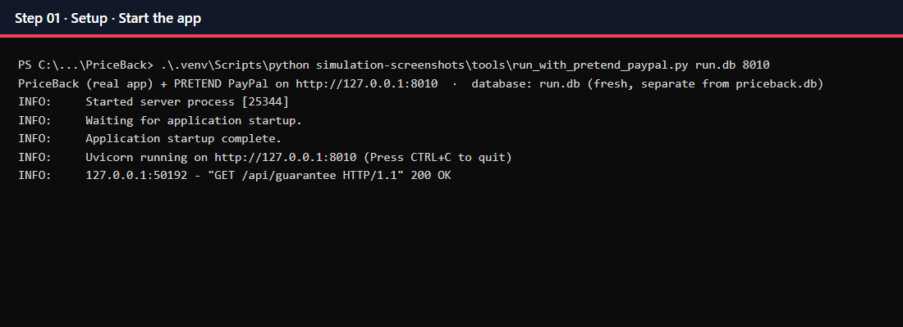

**How we got here:** Opened PowerShell in the project folder and started the app. (Your normal command is `.\.venv\Scripts\python -m uvicorn app.main:app --reload`. This run used a small launcher that starts the **same app**, but with a fresh database and the pretend PayPal; see *How this run was made*.)

**Data entered:** nothing typed

**What you see:** `Application startup complete.` The app is listening on port 8010.

**Behind the scenes:** FastAPI starts, creates an empty SQLite database and loads the 6 demo products.

---

### Part A · Merchant

#### 02 · Open the merchant dashboard and log in

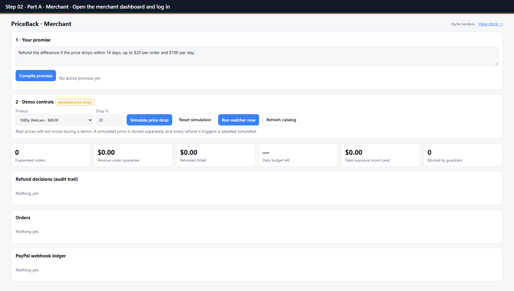

**How we got here:** Opened **http://127.0.0.1:8010/merchant**. The browser showed a small **"Admin token"** box **5 time(s)**. Each time we pasted the value after `ADMIN_TOKEN=` from `.env` and clicked **OK** (the box is a browser pop-up, so it doesn't appear in screenshots).

**Data entered:** Admin token from `.env` (not shown here, it's a password)

**What you see:** Next to the Compile button: *No active promise yet*. All tiles are 0 and every table says *Nothing yet.*

**Behind the scenes:** The merchant API refuses requests without the token (HTTP 401). The page asks for it once, then keeps it for this tab.

#### 03 · Type the promise in plain English

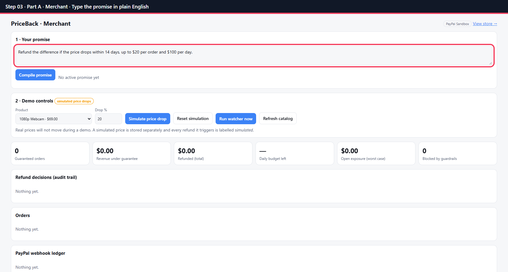

**How we got here:** Clicked into the **1 · Your promise** box and typed the sentence below (red box).

**Data entered:** `Refund the difference if the price drops within 14 days, up to $20 per order and $100 per day.`

**What you see:** The sentence is in the box; nothing has happened yet.

#### 04 · Compile the promise into numbers

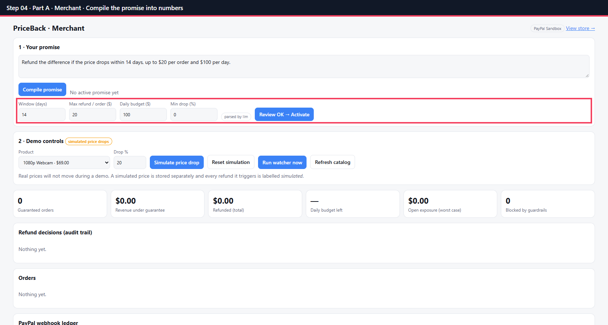

**How we got here:** Clicked **Compile promise**.

**Data entered:** (the sentence from the previous step)

**What you see:** Four editable boxes: Window (days) **14**, Max refund / order ($) **20**, Daily budget ($) **100**, Min drop (%) **0**, and the badge **parsed by llm** (*llm* = Gemini read it, *rules* = the backup regex parser read it).

**Behind the scenes:** The AI only turns the sentence into these 4 numbers; they are validated against hard limits (window 1–90 days, cap up to $1,000). **The AI never touches money.** You review the numbers next.

#### 05 · Activate the promise

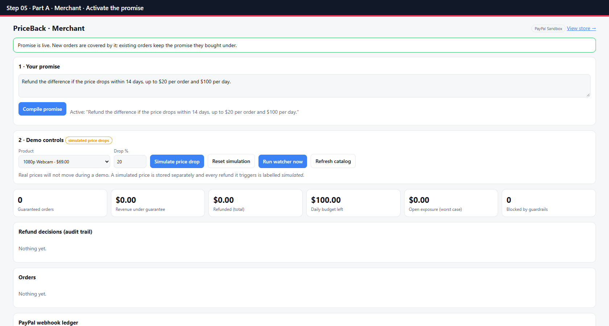

**How we got here:** Checked the numbers match the sentence and clicked **Review OK → Activate** (no changes).

**Data entered:** nothing typed

**What you see:** Green message: *Promise is live. New orders are covered by it; existing orders keep the promise they bought under.* and the label now reads *Active: “Refund the difference if the price drops within 14 days, up to $20 per order and $100 per day.”*.

**Behind the scenes:** The validated policy is saved as the active promise. Only orders placed **from now on** are covered.

---

### Part B · Shopper

#### 06 · Open the store

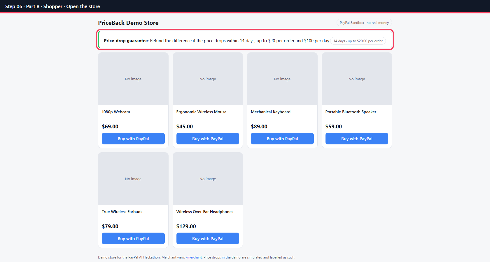

**How we got here:** Opened a new tab at **http://127.0.0.1:8010/**.

**Data entered:** nothing typed

**What you see:** Banner: *Price-drop guarantee: Refund the difference if the price drops within 14 days, up to $20 per order and $100 per day. (14 days · up to $20.00 per order)* and 6 products with **Buy with PayPal** buttons.

**Behind the scenes:** The banner comes from `GET /api/guarantee`, the promise you just activated.

#### 07 · Click Buy with PayPal on Wireless Over-Ear Headphones

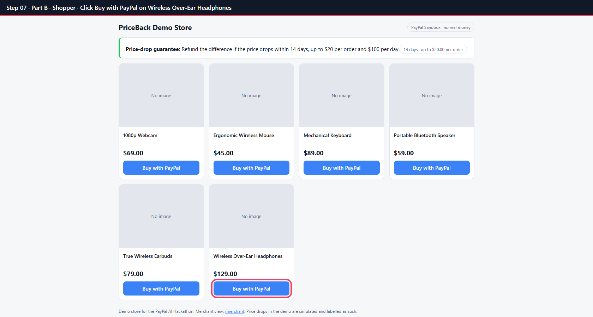

**How we got here:** In the store tab, find the **Wireless Over-Ear Headphones — $129.00** card and click **Buy with PayPal** (red box).

**Data entered:** nothing typed

**What you see:** The store still shows the green guarantee banner, so this purchase will be covered.

**Behind the scenes:** Clicking calls `POST /api/checkout` with only the product id. The server looks the price up in its own catalog and asks PayPal to create an order for that amount, so the browser can never change the price.

#### 08 · PayPal checkout page (pretend)

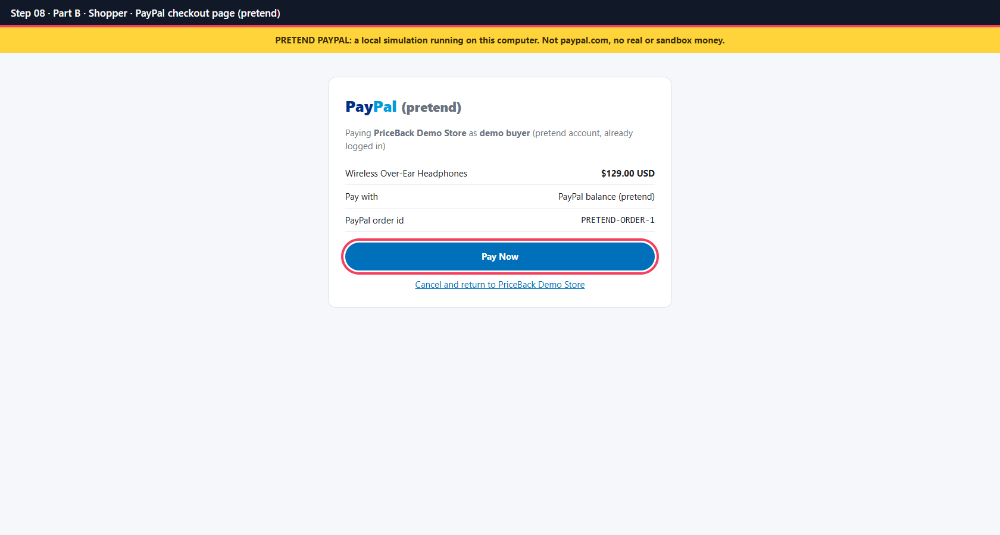

**How we got here:** The browser was sent to the PayPal approval page returned by `POST /api/checkout`.

**Data entered:** nothing typed

**What you see:** The amount is **$129.00 USD** for *Wireless Over-Ear Headphones*, with a **Pay Now** button.

**Behind the scenes:** **With the real PayPal sandbox this is where you log in:** *Email or mobile number* = your **Personal (US)** sandbox email (`sb-…@personal.example.com`) → **Next** → *Password* = its password → **Log In** → **Pay Now**. Here the pretend PayPal skips the login (pretend buyer already logged in).

#### 09 · Back on the store: payment received (order #1)

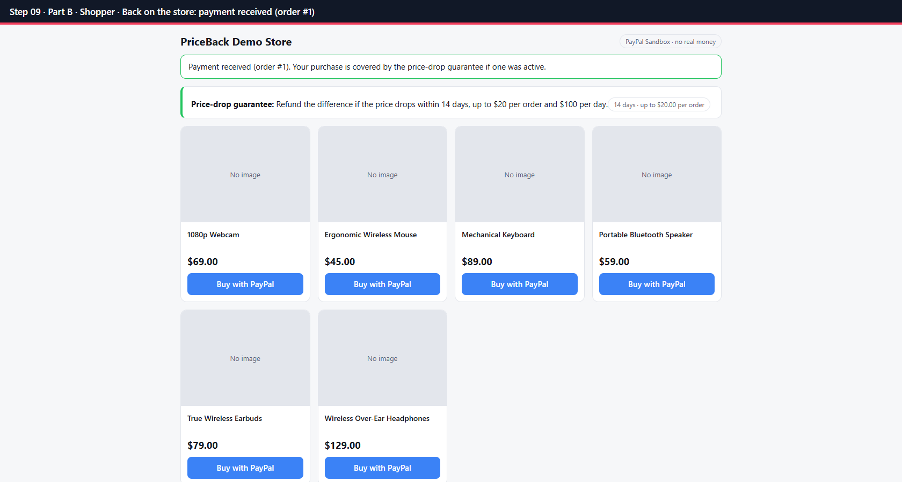

**How we got here:** Clicked **Pay Now**. PayPal sent the browser back to `/checkout/return?token=…`, and the server redirected to `/?paid=1`.

**Data entered:** nothing typed

**What you see:** Green message: *Payment received (order #1). Your purchase is covered by the price-drop guarantee if one was active.*

**Behind the scenes:** On return the server **captures** the payment (takes the money), checks PayPal captured exactly the catalog price, and saves a **copy of the active promise onto the order** (snapshot). If the merchant changes the promise later, this order keeps the terms it was bought under.

---

### Part B · Merchant

#### 10 · The paid order on the dashboard

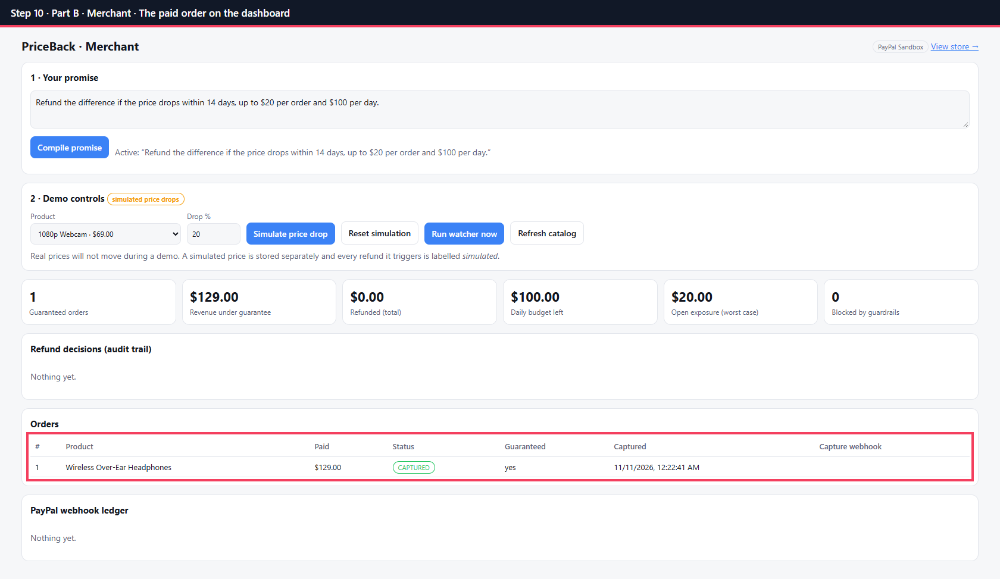

**How we got here:** Switched back to the merchant tab and pressed **F5**.

**Data entered:** nothing typed

**What you see:** Orders table: *1 | Wireless Over-Ear Headphones | $129.00 | CAPTURED | yes | 11/11/2026, 12:22:41 AM | *. Tiles: Guaranteed orders: **1** · Revenue under guarantee: **$129.00** · Refunded (total): **$0.00** · Daily budget left: **$100.00** · Open exposure (worst case): **$20.00** · Blocked by guardrails: **0**.

**Behind the scenes:** *Open exposure* is the most PriceBack could still owe: the $20 per-order cap.

---

### Part C · Price drop

#### 11 · Reset any old simulated prices

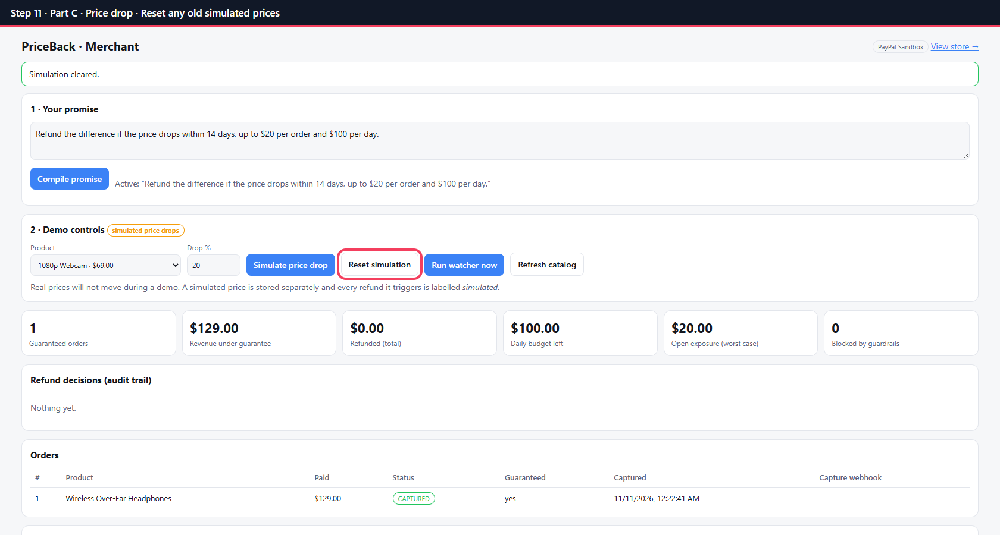

**How we got here:** In **2 · Demo controls**, clicked **Reset simulation**.

**Data entered:** nothing typed

**What you see:** Message: *Simulation cleared.*

**Behind the scenes:** Removes any fake prices so we start from the real catalog prices.

#### 12 · Choose the product and the drop

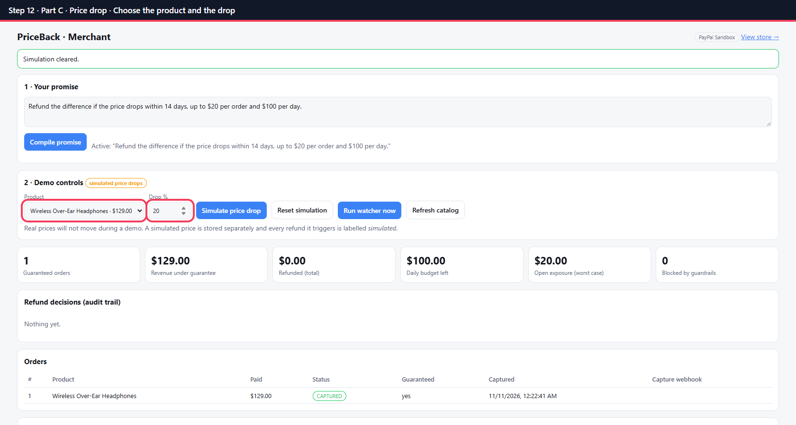

**How we got here:** Picked the product in the **Product** dropdown and typed the percentage in **Drop %** (red boxes).

**Data entered:** Product = **Wireless Over-Ear Headphones · $129.00**, Drop % = **20**

**What you see:** The form is filled; nothing has happened yet.

#### 13 · Simulate the price drop

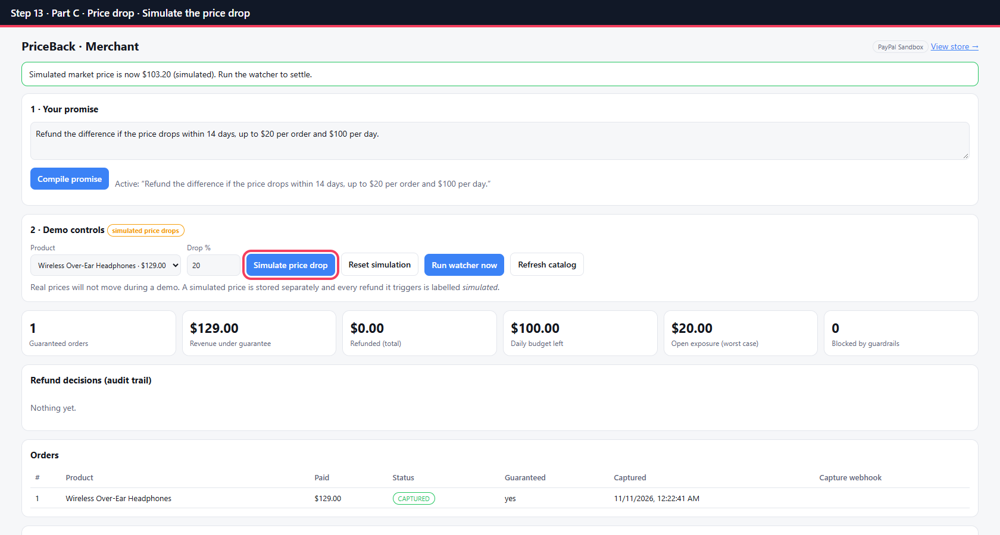

**How we got here:** Clicked **Simulate price drop**.

**Data entered:** nothing typed

**What you see:** Message: *Simulated market price is now $103.20 (simulated). Run the watcher to settle.*

**Behind the scenes:** Real prices don't move during a demo, so a **simulated** market price is stored separately and everything it causes is labelled `simulated`.

#### 14 · Run the watcher: automatic refund

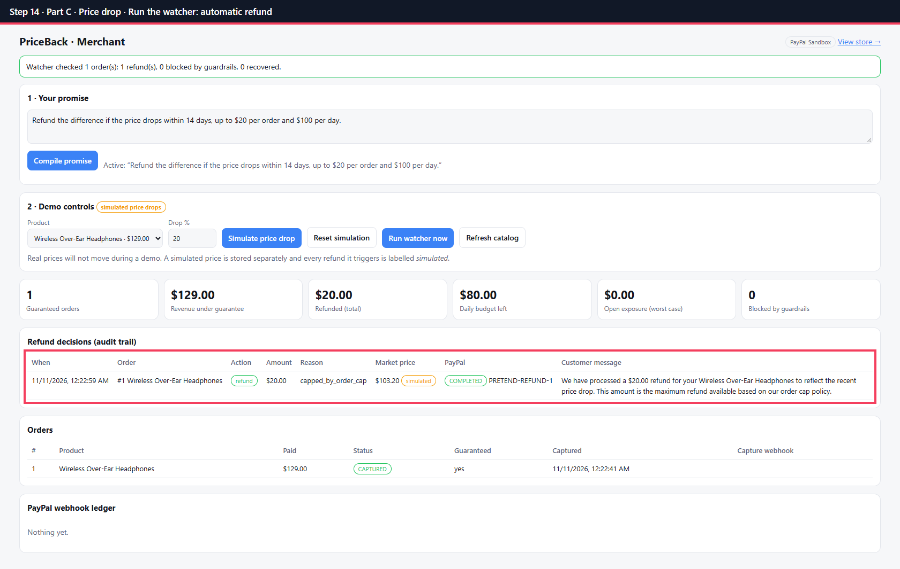

**How we got here:** Clicked **Run watcher now**.

**Data entered:** nothing typed

**What you see:** Message: *Watcher checked 1 order(s): 1 refund(s), 0 blocked by guardrails, 0 recovered.*  
New audit row: *11/11/2026, 12:22:59 AM | #1 Wireless Over-Ear Headphones | refund | $20.00 | capped_by_order_cap | $103.20 simulated | COMPLETED PRETEND-REFUND-1 | We have processed a $20.00 refund for your Wireless Over-Ear Headphones to reflect the recent price drop. This amount is the maximum refund available based on our order cap policy.*  
Tiles: Guaranteed orders: **1** · Revenue under guarantee: **$129.00** · Refunded (total): **$20.00** · Daily budget left: **$80.00** · Open exposure (worst case): **$0.00** · Blocked by guardrails: **0**

**Behind the scenes:** Paid $129.00, market $103.20, so $25.80 is owed. The per-order cap left is $20.00 and the daily budget left is $100.00. **Refund = the smallest = $20.00** (`capped_by_order_cap`). The decision is written to the database first (locked), then the refund is sent to PayPal with a unique `PayPal-Request-Id` so a retry can't pay twice. Gemini (or a template) writes the customer message.

---

### Part C · Check PayPal

#### 15 · The refund arrived at PayPal (pretend activity page)

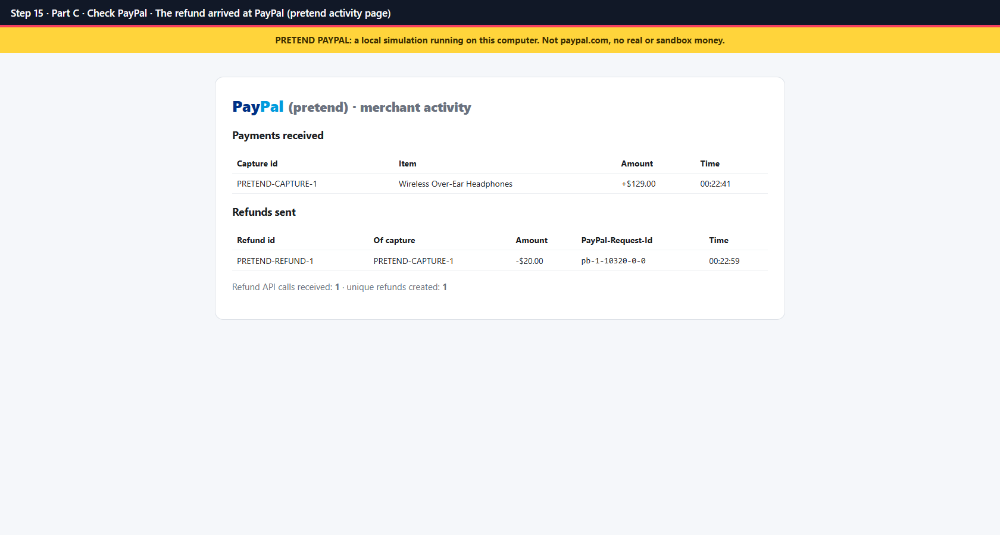

**How we got here:** Opened **http://127.0.0.1:8010/pretend-paypal/activity**, which stands in for the guide's Step 7.

**Data entered:** nothing typed

**What you see:** Payments received: the $129.00 capture. Refunds sent: one refund of $20.00 with its PayPal-Request-Id.

**Behind the scenes:** **With the real sandbox:** open a private window → https://www.sandbox.paypal.com → log in with the **Business (US)** sandbox account → **Activity**. You'd see the $129.00 payment and the $20.00 refund.

---

### Part D · Guardrail

#### 16 · Run again: blocked by the per-order cap

**How we got here:** Changed nothing and clicked **Run watcher now** again.

**Data entered:** nothing typed

**What you see:** Message: *Watcher checked 1 order(s): 0 refund(s), 1 blocked by guardrails, 0 recovered.*  
New audit row: *11/11/2026, 12:23:10 AM | #1 Wireless Over-Ear Headphones | blocked | $0.00 | order_cap_reached | $103.20 simulated |  | *

**Behind the scenes:** $5.80 is technically still owed ($25.80 − $20.00), but this order already used its whole $20 cap. The cap is **cumulative** across refunds on the same order.

#### 17 · Run a third time: no duplicate log rows

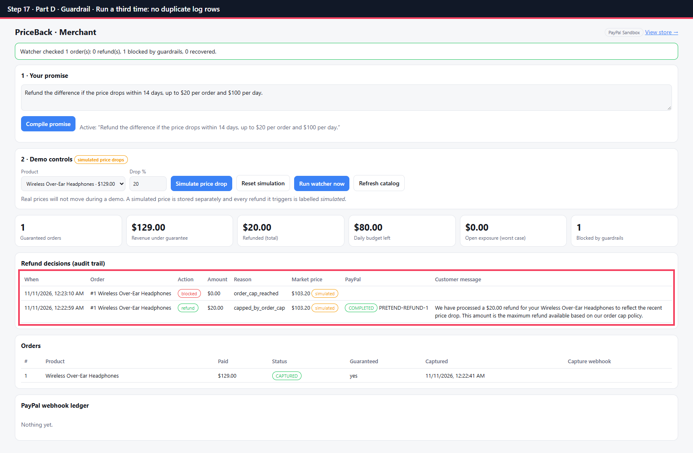

**How we got here:** Clicked **Run watcher now** a third time.

**Data entered:** nothing typed

**What you see:** Message: *Watcher checked 1 order(s): 0 refund(s), 1 blocked by guardrails, 0 recovered.*. Audit rows before: **2**, after: **2**, so no new row was added.

**Behind the scenes:** The same block for the same price is logged once, not every time the watcher runs.

---

### Scenario A · Shopper

#### 18 · Back on the store: payment received (order #2)

**How we got here:** Clicked **Pay Now**. PayPal sent the browser back to `/checkout/return?token=…`, and the server redirected to `/?paid=2`. (Same steps as before: Buy with PayPal on the mouse → Pay Now.)

**Data entered:** nothing typed

**What you see:** Green message: *Payment received (order #2). Your purchase is covered by the price-drop guarantee if one was active.*

**Behind the scenes:** On return the server **captures** the payment (takes the money), checks PayPal captured exactly the catalog price, and saves a **copy of the active promise onto the order** (snapshot). If the merchant changes the promise later, this order keeps the terms it was bought under.

---

### Scenario A · Small drop

#### 19 · Mouse drops 10%

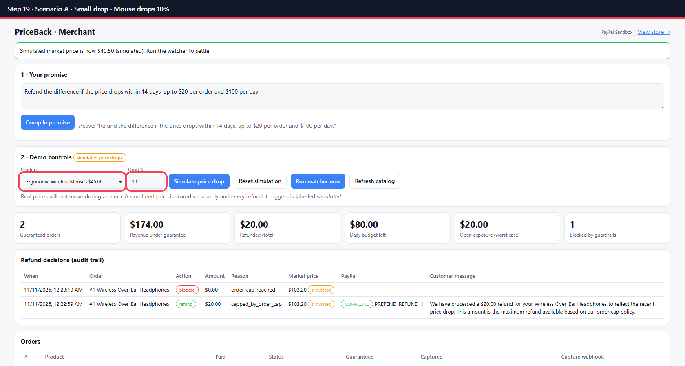

**How we got here:** Merchant tab: **Reset simulation**, then Product = mouse, Drop % = 10, then **Simulate price drop**.

**Data entered:** Product = **Ergonomic Wireless Mouse · $45.00**, Drop % = **10**

**What you see:** Message: *Simulated market price is now $40.50 (simulated). Run the watcher to settle.*

#### 20 · Full difference refunded

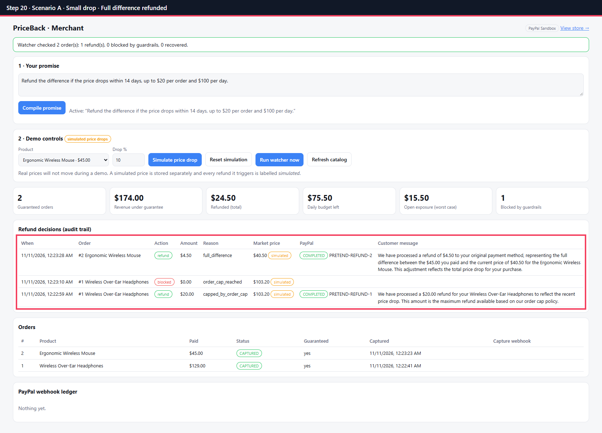

**How we got here:** Clicked **Run watcher now**.

**Data entered:** nothing typed

**What you see:** Message: *Watcher checked 2 order(s): 1 refund(s), 0 blocked by guardrails, 0 recovered.*  
New audit row: *11/11/2026, 12:23:28 AM | #2 Ergonomic Wireless Mouse | refund | $4.50 | full_difference | $40.50 simulated | COMPLETED PRETEND-REFUND-2 | We have processed a refund of $4.50 to your original payment method, representing the full difference between the $45.00 you paid and the current price of $40.50 for the Ergonomic Wireless Mouse. This adjustment reflects the total price drop for your purchase.*

**Behind the scenes:** $45.00 − $40.50 = $4.50 owed, which is below the $20 cap, so it's refunded in full (`full_difference`). The headphones order was checked too, but its price is back to normal after the reset, so nothing happened.

---

### Scenario B · Further drop

#### 21 · Price falls further: only the extra is refunded

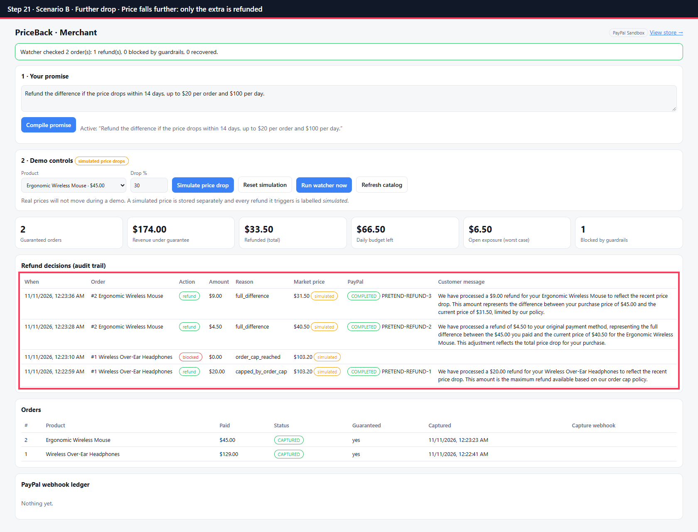

**How we got here:** Same product, Drop % = **30**, then **Simulate price drop**, then **Run watcher now**.

**Data entered:** Product = **Ergonomic Wireless Mouse**, Drop % = **30** (market $31.50)

**What you see:** Message: *Watcher checked 2 order(s): 1 refund(s), 0 blocked by guardrails, 0 recovered.*  
New audit row: *11/11/2026, 12:23:36 AM | #2 Ergonomic Wireless Mouse | refund | $9.00 | full_difference | $31.50 simulated | COMPLETED PRETEND-REFUND-3 | We have processed a $9.00 refund for your Ergonomic Wireless Mouse to reflect the recent price drop. This amount represents the difference between your purchase price of $45.00 and the current price of $31.50, limited by our policy.*  
Tiles: Guaranteed orders: **2** · Revenue under guarantee: **$174.00** · Refunded (total): **$33.50** · Daily budget left: **$66.50** · Open exposure (worst case): **$6.50** · Blocked by guardrails: **1**

**Behind the scenes:** Now owed: $45.00 − $31.50 = $13.50, minus the $4.50 already refunded = **$9.00**.

---

### Scenario C · No drop

#### 22 · Prices back to normal: nothing happens

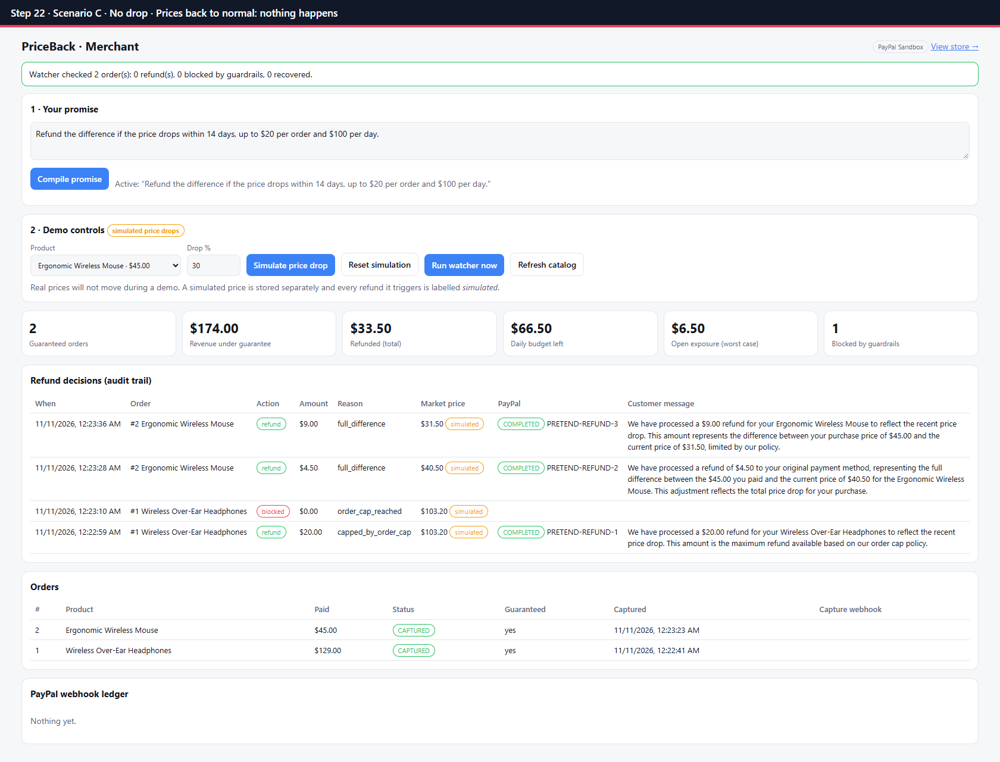

**How we got here:** Clicked **Reset simulation**, then **Run watcher now**.

**Data entered:** nothing typed

**What you see:** Message: *Watcher checked 2 order(s): 0 refund(s), 0 blocked by guardrails, 0 recovered.*. Audit rows before: **4**, after: **4**.

**Behind the scenes:** No price drop means `no_drop`, so it's skipped silently.

---

### Scenario D · Daily budget

#### 23 · Compile a promise with a $25 daily budget

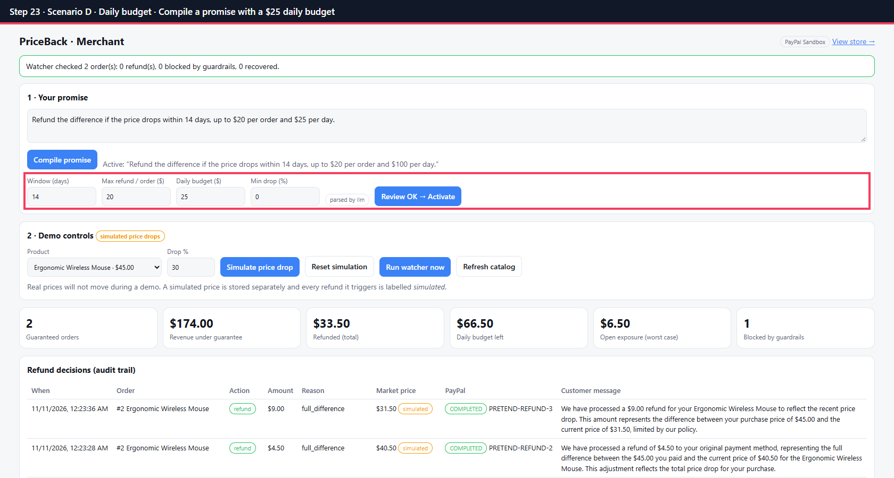

**How we got here:** Changed the promise text (only `$100` became `$25`) and clicked **Compile promise**.

**Data entered:** `Refund the difference if the price drops within 14 days, up to $20 per order and $25 per day.`

**What you see:** Daily budget ($) now **25** (window 14, cap 20), badge **parsed by llm**.

#### 24 · Daily budget used up: refund blocked

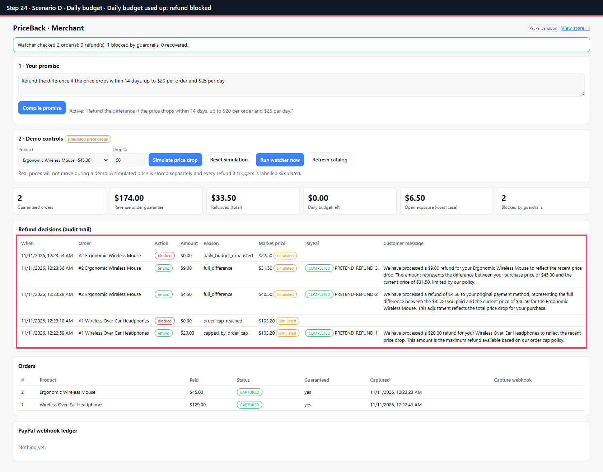

**How we got here:** Clicked **Review OK → Activate**, then Product = mouse, Drop % = **50**, then **Simulate price drop**, then **Run watcher now**.

**Data entered:** Promise with **$25 per day**; mouse market price $22.50

**What you see:** Message: *Watcher checked 2 order(s): 0 refund(s), 1 blocked by guardrails, 0 recovered.*  
New audit row: *11/11/2026, 12:23:53 AM | #2 Ergonomic Wireless Mouse | blocked | $0.00 | daily_budget_exhausted | $22.50 simulated |  | *

**Behind the scenes:** The mouse would be owed $9.00 more, but **$33.50 was already refunded today**, more than the new $25 daily budget. The daily budget is shared by all orders and follows the currently active promise.

#### 25 · Put the $100 promise back

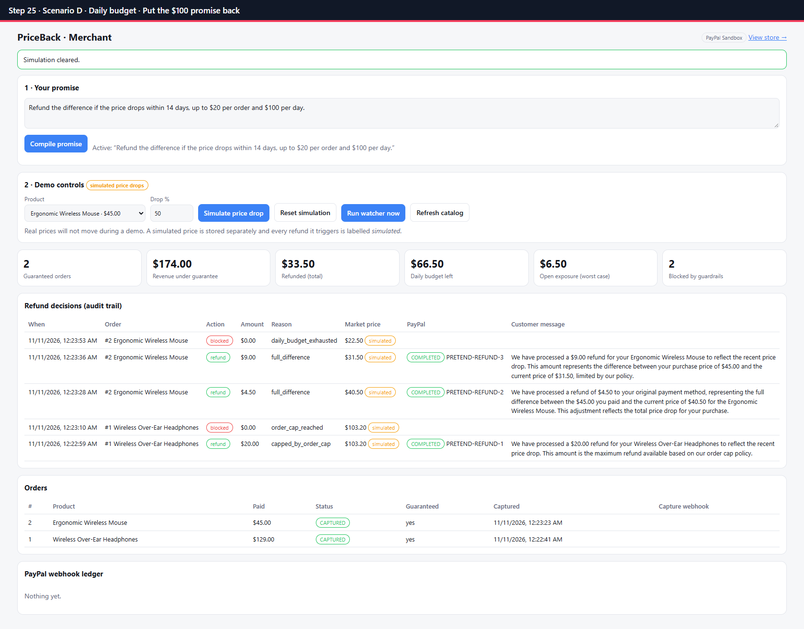

**How we got here:** Typed the original sentence, then **Compile promise**, then **Review OK → Activate**, then **Reset simulation**.

**Data entered:** `Refund the difference if the price drops within 14 days, up to $20 per order and $100 per day.`

**What you see:** *Active: “Refund the difference if the price drops within 14 days, up to $20 per order and $100 per day.”*. Final tiles: Guaranteed orders: **2** · Revenue under guarantee: **$174.00** · Refunded (total): **$33.50** · Daily budget left: **$66.50** · Open exposure (worst case): **$6.50** · Blocked by guardrails: **2**.

**Behind the scenes:** Everything that happened is in the audit trail below (newest first).

---

### Wrap-up

#### 26 · Everything PayPal saw (pretend activity page)

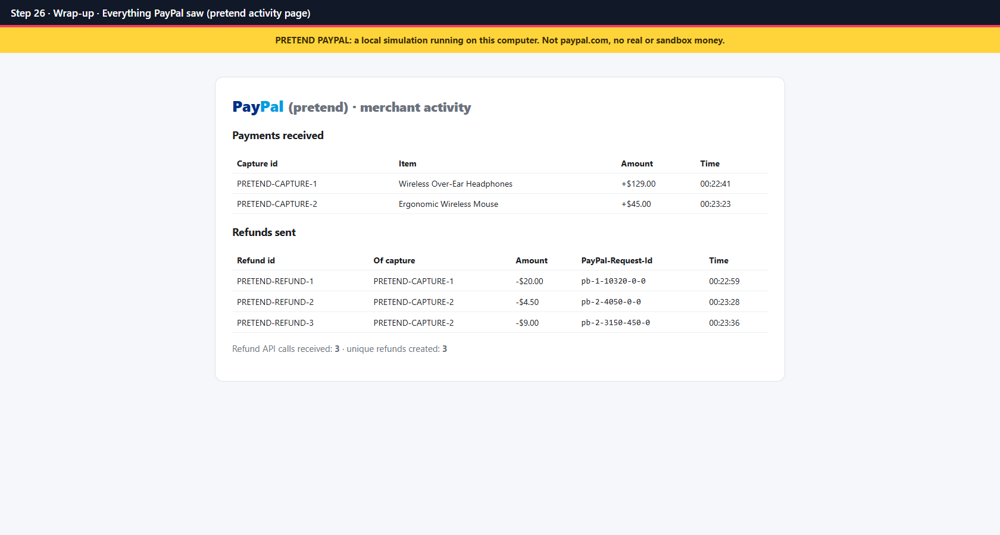

**How we got here:** Reloaded **http://127.0.0.1:8010/pretend-paypal/activity**.

**Data entered:** nothing typed

**What you see:** 2 payments ($129.00, $45.00) and 3 refunds ($20.00, $4.50, $9.00). The blocked attempts never reached PayPal.

**Behind the scenes:** Total refunded $33.50 against $174.00 of guaranteed sales, every cent inside the promise's limits.

---

### Tests

#### 27 · Run the automated tests

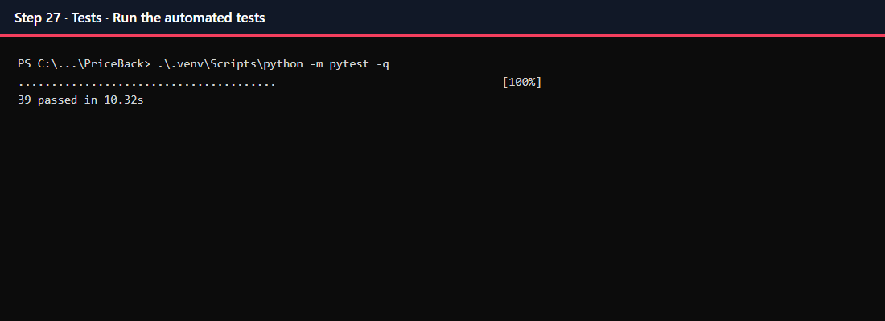

**How we got here:** In a second PowerShell window (project folder) ran `.\.venv\Scripts\python -m pytest -q`.

**Data entered:** nothing typed

**What you see:** `39 passed in 10.32s`

**Behind the scenes:** 39 tests cover promise parsing, every guardrail, no double refunds, the full checkout → drop → refund flow, admin protection and webhook checks, all against a fake PayPal, so no internet is needed.
